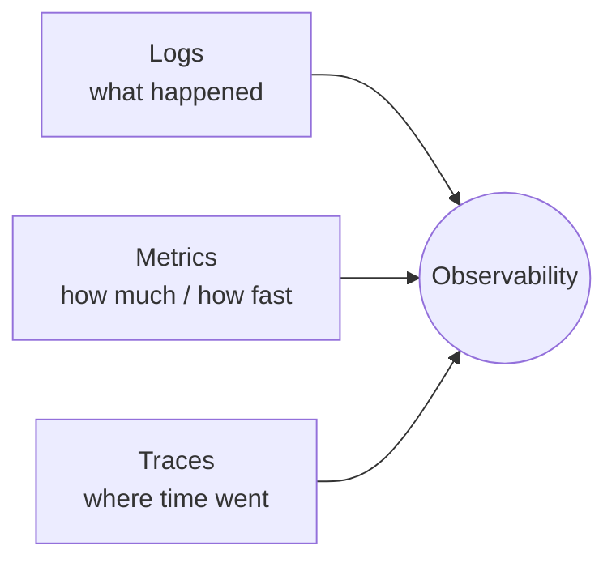
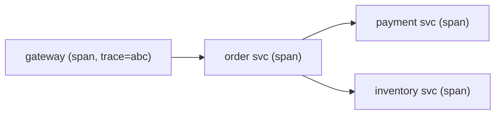

# Observability

You can't operate what you can't see. Observability is the ability to understand a
system's internal state from its outputs — essential for debugging distributed systems.

<ProgressTracker id="sd-observability" />

## Table of Contents

- [The three pillars](#the-three-pillars)
- [Logs](#logs)
- [Metrics & the golden signals](#metrics--the-golden-signals)
- [Distributed tracing](#distributed-tracing)
- [Correlation & trace IDs](#correlation--trace-ids)
- [OpenTelemetry & the stack](#opentelemetry--the-stack)
- [Interview questions](#interview-questions)
- [Things You Should Know](#things-you-should-know)

## The three pillars



<Important>
**Logs + Metrics + Traces** together answer different questions. Logs = discrete
events ("what happened, with detail"). Metrics = aggregated numbers over time ("error
rate, latency"). Traces = the path of one request across services ("where did the 2s
go?"). You need all three.
</Important>

## Logs

- **Structured logging** — emit JSON with fields (`level`, `service`, `traceId`,
  `userId`) so aggregators can index and query them.
- **Centralized logging** — ship logs off the host to a store (ELK/Loki/CloudWatch);
  never SSH into pods to `grep`.
- Use SLF4J with parameterized messages; **never log secrets or PII**.

```java
log.info("order placed orderId={} total={} traceId={}", id, total, traceId);
```

## Metrics & the golden signals

The **four golden signals** to monitor and alert on:

| Signal | Question |
| --- | --- |
| **Latency** | How long do requests take (p50/p95/p99)? |
| **Traffic** | How much demand (requests/sec)? |
| **Errors** | What fraction fails (5xx rate)? |
| **Saturation** | How full are resources (CPU/mem/pool)? |

Spring Boot exposes these via Actuator + Micrometer in Prometheus format; Grafana
visualizes and Alertmanager pages on breaches.

<Tip>
Track **percentiles (p95/p99)**, not averages. Averages hide the tail — the p99 is
what your unhappiest users feel, and it's usually where problems start.
</Tip>

## Distributed tracing

A **trace** follows one request across services as a tree of **spans** (each span = a
unit of work with start/end and metadata). It shows exactly where latency accumulates.



## Correlation & trace IDs

<Important>
A **correlation ID / trace ID** is generated at the edge and propagated through every
service (via headers) and every log line (via MDC). It lets you stitch together all
logs and spans for a single request across the whole system — the single most useful
debugging aid in microservices.
</Important>

## OpenTelemetry & the stack

- **OpenTelemetry (OTel)** — the vendor-neutral standard for generating and exporting
  logs, metrics, and traces. Spring Boot 3 uses Micrometer + Micrometer Tracing
  (OTel-compatible).
- Common stacks: **Prometheus + Grafana** (metrics), **ELK/Loki** (logs), **Jaeger /
  Tempo / Zipkin** (traces).

See [Production Backend](/docs/production/) for Spring specifics.

## Interview questions

- What are the three pillars of observability and what does each answer?
- What are the four golden signals?
- Why track p99 latency instead of the average?
- What is a correlation/trace ID and why does it matter in microservices?
- What does OpenTelemetry standardize?

## Things You Should Know

### 🔴 Must Know
- Logs + metrics + traces, and what each answers.
- Golden signals; percentiles over averages.
- Correlation/trace IDs across services.

### 🟡 Good to Know
- Structured + centralized logging; never log secrets.
- OpenTelemetry; Prometheus/Grafana/Jaeger.

### 🟢 Nice to Know
- SLOs/SLIs and error budgets; exemplars linking metrics to traces.
