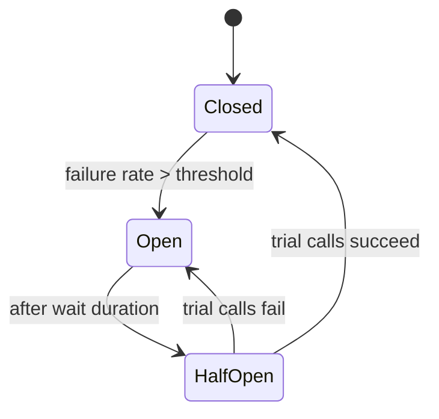
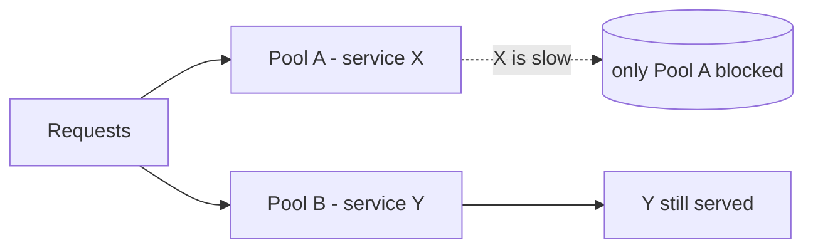

# Reliability & Fault Tolerance

Dependencies fail — always. Reliability is designing so one failure doesn't cascade
into an outage. Resilience4j is the go-to Java library.

<ProgressTracker id="sd-reliability" />

## Table of Contents

- [The failure mindset](#the-failure-mindset)
- [Timeout](#timeout)
- [Retry, backoff & jitter](#retry-backoff--jitter)
- [Circuit breaker](#circuit-breaker)
- [Bulkhead](#bulkhead)
- [Rate limiting & load shedding](#rate-limiting--load-shedding)
- [Graceful degradation](#graceful-degradation)
- [Failover & disaster recovery](#failover--disaster-recovery)
- [Interview questions](#interview-questions)
- [Things You Should Know](#things-you-should-know)

## The failure mindset

<Important>
Assume every network call can be slow, fail, or hang forever. The patterns below stop
a single slow dependency from consuming all your threads and taking down the whole
service (a **cascading failure**).
</Important>

## Timeout

Never wait indefinitely. Every remote call needs a timeout so a hung dependency
releases the thread. A missing timeout is the most common cause of cascading outages.

```java
@TimeLimiter(name = "pricing")
public CompletableFuture<Quote> quote(Order o) { ... }
```

## Retry, backoff & jitter

Retry **transient** failures, but not blindly:

- **Exponential backoff** — wait 1s, 2s, 4s… so you don't hammer a struggling service.
- **Jitter** — add randomness so all clients don't retry in sync (a "retry storm").

<Warning>
Only retry **idempotent** operations. Retrying a non-idempotent `POST` (a payment)
can double-charge. Combine retries with idempotency keys, and cap total attempts.
</Warning>

```java
@Retry(name = "pricing")   // Resilience4j: max attempts + exponential backoff + jitter
public Quote quote(Order o) { ... }
```

## Circuit breaker

When a dependency keeps failing, stop calling it — fail fast and give it time to
recover, instead of piling on requests.



- **Closed** — calls flow; failures counted.
- **Open** — calls short-circuit immediately (return fallback).
- **Half-open** — a few trial calls test recovery.

```java
@CircuitBreaker(name = "pricing", fallbackMethod = "cachedQuote")
public Quote quote(Order o) { ... }
private Quote cachedQuote(Order o, Throwable t) { return lastKnown(o); }
```

## Bulkhead

Isolate resources so one slow dependency can't exhaust every thread. Give each
downstream its own bounded pool — like watertight compartments in a ship.



## Rate limiting & load shedding

- **Rate limiting** caps requests per client to protect downstream (`429`). See the
  [rate-limiter design](/docs/system-design/rate-limiter/).
- **Load shedding** — under overload, deliberately reject low-priority requests early
  (fast `503`) to keep the system alive for the rest. Better to serve some than crash
  serving none.

## Graceful degradation

When a non-critical dependency is down, degrade instead of failing: serve stale cache,
hide a recommendations widget, queue the work for later. The core flow keeps working.

## Failover & disaster recovery

- **Failover** — automatically switch to a standby (replica, another AZ) when the
  primary fails. Health checks trigger it.
- **Disaster recovery** — plan for whole-region loss. Key metrics: **RTO** (recovery
  time objective — how fast you recover) and **RPO** (recovery point objective — how
  much data loss is tolerable). Backups + multi-region replication drive these.

## Interview questions

- Why is a missing timeout dangerous?
- Why add jitter to retries? What must be true to retry safely?
- Explain the circuit-breaker states.
- What problem does the bulkhead pattern solve?
- Rate limiting vs load shedding?
- RTO vs RPO?

## Things You Should Know

### 🔴 Must Know
- Timeout every call; retry only idempotent ops with backoff + jitter.
- Circuit breaker states and purpose.
- Graceful degradation over hard failure.

### 🟡 Good to Know
- Bulkhead isolation; load shedding; failover.
- Resilience4j annotations.

### 🟢 Nice to Know
- RTO/RPO; multi-region DR; retry budgets.
