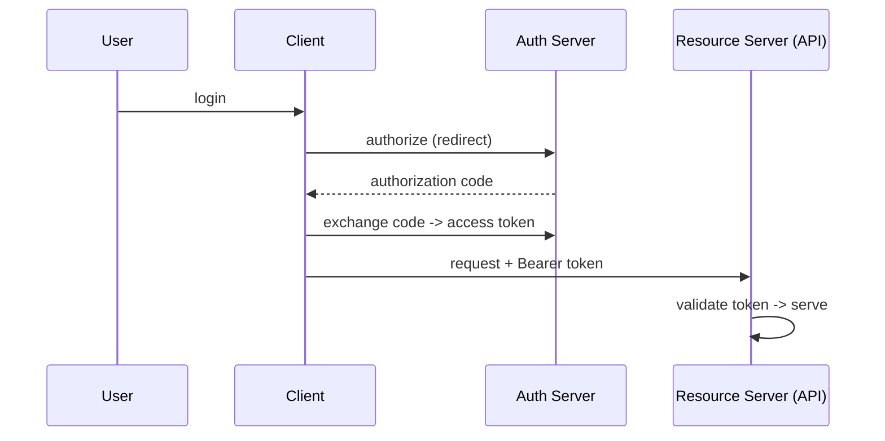

# Security in System Design

Security is not a feature you add later — it's a property of the architecture. A
senior design always accounts for how identity, access, and data are protected.

<ProgressTracker id="sd-security" />

## Table of Contents

- [Authentication vs authorization](#authentication-vs-authorization)
- [Tokens: JWT, access & refresh](#tokens-jwt-access--refresh)
- [OAuth2 & OpenID Connect](#oauth2--openid-connect)
- [Session vs token auth](#session-vs-token-auth)
- [RBAC & API keys](#rbac--api-keys)
- [Transport & data security](#transport--data-security)
- [Common attacks](#common-attacks)
- [Secrets management](#secrets-management)
- [Interview questions](#interview-questions)
- [Things You Should Know](#things-you-should-know)

## Authentication vs authorization

- **Authentication (AuthN)** — *who are you?* (verify identity).
- **Authorization (AuthZ)** — *what may you do?* (check permissions).

They're separate concerns and often separate components: an auth server issues
identity; each service enforces access.

## Tokens: JWT, access & refresh

A **JWT** is a signed `header.payload.signature` token carrying claims (subject,
roles, expiry). It's signed, **not encrypted** — readable by anyone.

| | Access token | Refresh token |
| --- | --- | --- |
| Lifetime | Short (5–15 min) | Long (days) |
| Sent | Every request | Only to refresh endpoint |
| Revocation | Expires fast | Stored server-side, revocable |

<Warning>
Never put secrets in a JWT payload — it's base64, not encryption. Keep access tokens
short-lived; since they're stateless you can't revoke them before expiry, so use a
revocable refresh token (or token version) for logout. Full flow:
[JWT Authentication](/docs/security/jwt-authentication/).
</Warning>

## OAuth2 & OpenID Connect

- **OAuth2** — a **delegated authorization** framework. An auth server issues access
  tokens so a client can call an API on a user's behalf, without handling the
  password.
- **OpenID Connect (OIDC)** — an identity layer on top of OAuth2 that adds an
  **ID token** (who the user is). "Login with Google" is OIDC.

Your Spring Boot API is usually an **OAuth2 Resource Server** that validates the JWT,
not a password handler.

## Session vs token auth

| | Session (cookie) | Token (JWT) |
| --- | --- | --- |
| State | Server-side session store | Stateless (self-contained) |
| Scaling | Needs shared session store / sticky | Scales freely |
| Revocation | Easy (delete session) | Hard (wait for expiry) |
| CSRF | Vulnerable (cookies) | Not if token in `Authorization` header |

## RBAC & API keys

- **RBAC (Role-Based Access Control)** — assign permissions to roles, roles to users
  (`ROLE_ADMIN`, `ROLE_USER`). Enforce with `@PreAuthorize("hasRole('ADMIN')")`.
- **API keys** — simple shared secrets for service/partner access; coarse-grained,
  rotate regularly, scope them, and never embed in client-side code.

## Transport & data security

- **HTTPS/TLS** everywhere — encrypt data **in transit**. Terminate TLS at the load
  balancer/gateway.
- **Encryption at rest** — encrypt databases, disks, and backups.
- Hash passwords with **BCrypt** (salted, adaptive) — never store plaintext.

## Common attacks

<Important>
Know these by name and defense:
- **SQL injection** → parameterized queries / `PreparedStatement` (never concatenate input).
- **XSS (cross-site scripting)** → output encoding, Content-Security-Policy, sanitize input.
- **CSRF** → CSRF tokens for cookie-based auth; not an issue for header bearer tokens.
- **CORS** → server opts in to specific origins (never `*` with credentials).
</Important>

## Secrets management

<Warning>
Never commit secrets or bake them into images/layers. Store them in a secrets manager
(AWS Secrets Manager, Vault, Kubernetes Secrets) and inject at runtime. Rotate keys,
scope access least-privilege, and audit usage.
</Warning>

## Interview questions

- AuthN vs AuthZ?
- How does OAuth2 differ from OIDC?
- Session vs token authentication trade-offs?
- Why is a JWT signed but not encrypted, and what follows from that?
- How do you prevent SQL injection, XSS, and CSRF?
- Where do secrets live in your architecture?

## Things You Should Know

### 🔴 Must Know
- AuthN vs AuthZ; JWT access/refresh; RBAC.
- TLS in transit, encryption at rest, BCrypt.
- Injection/XSS/CSRF/CORS defenses.

### 🟡 Good to Know
- OAuth2 vs OIDC; resource server validation.
- Session vs token trade-offs; API keys.

### 🟢 Nice to Know
- mTLS between services; secret rotation; JWKS/RS256.
