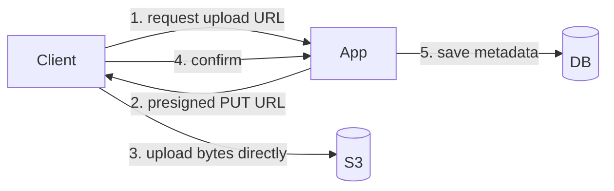
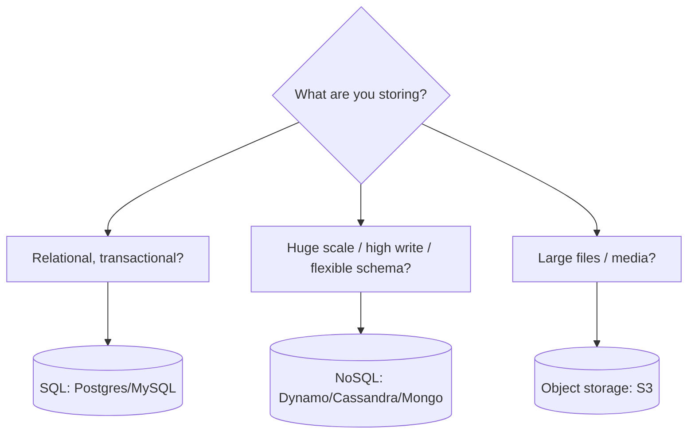

# Storage Choices

"Which database?" is one of the first design decisions and one of the most consequential.
Match the store to the access pattern, not to hype.

<ProgressTracker id="sd-storage" />

## Table of Contents

- [SQL (relational)](#sql-relational)
- [NoSQL](#nosql)
- [Object storage](#object-storage)
- [Presigned URLs & multipart upload](#presigned-urls--multipart-upload)
- [Choosing a store](#choosing-a-store)
- [Interview questions](#interview-questions)
- [Things You Should Know](#things-you-should-know)

## SQL (relational)

**PostgreSQL, MySQL.** Use when you need:

- **Transactions** and strong consistency (payments, orders, balances).
- **Relationships** and joins across normalized data.
- **Complex queries**, aggregations, and ad-hoc reporting.
- A well-understood, safe default.

<Tip>
Start with a relational database unless you have a concrete reason not to. Postgres
scales further than most people assume (replicas, partitioning) and gives you ACID
for free.
</Tip>

## NoSQL

A family of non-relational stores, each optimized for a pattern:

| Type | Examples | Strength |
| --- | --- | --- |
| **Document** | MongoDB | Flexible schema, nested docs |
| **Key-value** | DynamoDB, Redis | Fast lookups by key, huge scale |
| **Wide-column** | Cassandra | High write throughput, linear scale |
| **Graph** | Neo4j | Relationship-heavy traversals |

Use NoSQL for **huge scale**, **flexible/evolving schema**, **very high write
throughput**, or **known access patterns** you can model the data around.

<Warning>
NoSQL isn't "SQL but faster". You typically give up joins, multi-row ACID, and ad-hoc
queries. You must **model around your queries** up front (especially Cassandra/Dynamo:
design the partition key for your read pattern). Wrong access patterns → hot
partitions and expensive scatter-gather reads.
</Warning>

## Object storage

**S3, Azure Blob, GCS.** For large binary blobs: images, videos, documents, backups.
Cheap, virtually infinite, durable, and served over HTTP. Store the **file in object
storage** and the **metadata (owner, key, size, type) in a database**.

## Presigned URLs & multipart upload

<Important>
Never stream large uploads/downloads through your app servers — it wastes bandwidth
and makes instances stateful. Issue a **presigned URL** (a time-limited, signed link)
so the client uploads/downloads **directly** to/from object storage. Your service only
records metadata. Use **multipart upload** for large files (parallel chunks, resumable).
</Important>

Combine with a [CDN](/docs/system-design/concepts/cdn/) to serve downloads from the edge.

## Choosing a store

Real systems use **several**: Postgres for orders, Redis for cache/sessions, S3 for
media, Elasticsearch for search, Kafka for events. This is **polyglot persistence** —
pick the right tool per workload.

## Interview questions

- SQL vs NoSQL — how do you decide?
- Why model NoSQL around access patterns?
- Where do you store user-uploaded images and why not in the DB?
- What is a presigned URL and what problem does it solve?
- What is polyglot persistence?

## Things You Should Know

### 🔴 Must Know
- SQL for transactions/relationships; object storage for files.
- Presigned URLs; store metadata in DB, blob in S3.
- Match store to access pattern.

### 🟡 Good to Know
- NoSQL families and their strengths/trade-offs.
- Multipart upload; polyglot persistence.

### 🟢 Nice to Know
- Wide-column partition-key modeling; time-series and search stores.
