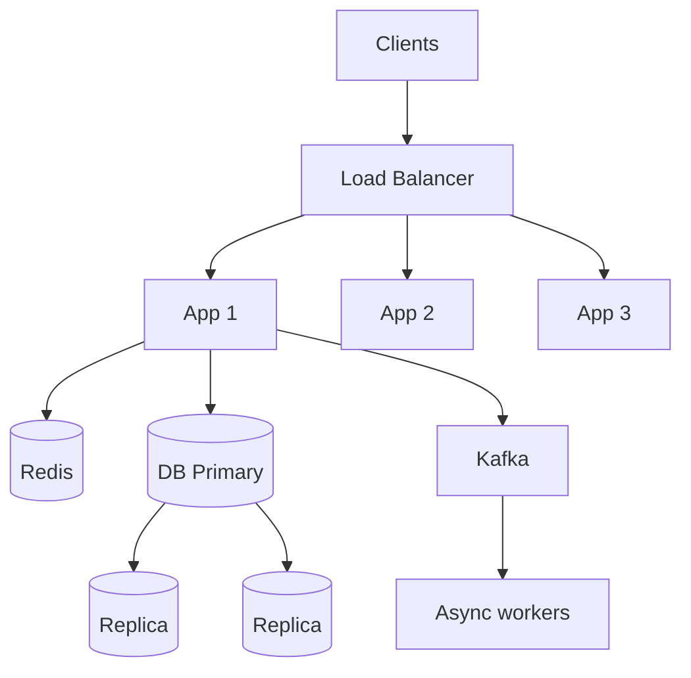

# System Design

System design interviews test whether you can turn vague requirements into a
scalable, reliable architecture and defend the trade-offs. This section covers the
building blocks, then applies them to ten real systems.

<ProgressTracker id="system-design-overview" />

## Table of Contents

- [The fundamentals](#the-fundamentals)
- [A framework for any design](#a-framework-for-any-design)
- [Scaling building blocks](#scaling-building-blocks)
- [CAP theorem](#cap-theorem)
- [Core concepts](#core-concepts)
- [Worked designs](#worked-designs)
- [Most Asked Interview Questions](#most-asked-interview-questions)
- [Things You Should Know](#things-you-should-know)

## The fundamentals

- **Scalability** — handle more load by adding resources.
- **Availability** — the fraction of time the system serves requests (99.9% ≈ 8.7h
  downtime/year).
- **Reliability** — it works correctly even when components fail.
- **Latency vs throughput** — response time per request vs requests per second.

**Vertical scaling** (bigger machine) is simple but capped and a single point of
failure. **Horizontal scaling** (more machines) is the path to real scale but
requires statelessness, load balancing, and distributed data.

## A framework for any design

Answer these in order — it's the structure interviewers expect:

```text
Requirements  →  APIs  →  Data model  →  High-level architecture
→  Database choice  →  Scaling strategy  →  Caching  →  Messaging
→  Failure scenarios  →  Trade-offs
```

<Tip>
Always start by clarifying **functional** requirements (what it does) and
**non-functional** ones (scale, latency, consistency). Then estimate load (QPS,
storage) before drawing boxes. Designing without numbers is guessing.
</Tip>

## Scaling building blocks

| Block | Solves |
| --- | --- |
| **Load balancer** | Distributes traffic across stateless app instances |
| **Cache (Redis/CDN)** | Cuts latency and DB load for hot/read-heavy data |
| **CDN** | Serves static assets close to users |
| **Read replicas** | Scale reads; primary handles writes |
| **Sharding** | Partition data across nodes to scale writes/storage |
| **Message queue (Kafka)** | Decouple, buffer spikes, enable async work |
| **Consistent hashing** | Distribute keys with minimal reshuffling on scale changes |



## CAP theorem

In a network **partition** you must choose between **consistency** (every read sees
the latest write) and **availability** (every request gets a response). You cannot
have both during a partition.

- **CP** systems (e.g. traditional RDBMS with sync replication) reject requests to
  stay consistent.
- **AP** systems (e.g. Cassandra, DynamoDB) stay available and reconcile later
  (**eventual consistency**).

<Interview>
Most real systems are **eventually consistent** where they can afford to be (feeds,
counts, caches) and **strongly consistent** where they must be (payments, inventory,
account balances). Being able to say *which parts* need which is the mark of
seniority.
</Interview>

## Core concepts

Master these building blocks first — every case study is an assembly of them. This
is the "MUST KNOW" theory backend engineers are expected to explain fluently.

<div className="jbm-card-grid">
  <Link className="jbm-card" to="/docs/system-design/concepts/fundamentals">
    <div className="jbm-card__icon">🧱</div>
    <h3>1. Fundamentals & HTTP/APIs</h3>
    <p>Architecture tiers, monolith vs microservices, scaling, REST vs gRPC, webhooks, polling vs SSE vs WebSockets.</p>
  </Link>
  <Link className="jbm-card" to="/docs/system-design/concepts/database-scaling">
    <div className="jbm-card__icon">🗄️</div>
    <h3>2. Databases at Scale</h3>
    <p>Indexes, replicas, partitioning, sharding, replication, connection pooling.</p>
  </Link>
  <Link className="jbm-card" to="/docs/system-design/concepts/caching">
    <div className="jbm-card__icon">⚡</div>
    <h3>3. Caching</h3>
    <p>Patterns, TTL, eviction, stampede, penetration, distributed locks.</p>
  </Link>
  <Link className="jbm-card" to="/docs/system-design/concepts/load-balancing">
    <div className="jbm-card__icon">⚖️</div>
    <h3>4. Load Balancing</h3>
    <p>L4 vs L7, algorithms, health checks, sticky sessions, reverse proxy.</p>
  </Link>
  <Link className="jbm-card" to="/docs/system-design/concepts/distributed-systems">
    <div className="jbm-card__icon">🌐</div>
    <h3>5. Distributed Systems</h3>
    <p>CAP, consistency models, consensus, quorum, split brain, partitions.</p>
  </Link>
  <Link className="jbm-card" to="/docs/system-design/concepts/messaging">
    <div className="jbm-card__icon">📨</div>
    <h3>6. Messaging & Events</h3>
    <p>Kafka vs RabbitMQ, pub/sub, delivery semantics, DLQ, consumer lag.</p>
  </Link>
  <Link className="jbm-card" to="/docs/system-design/concepts/reliability">
    <div className="jbm-card__icon">🛡️</div>
    <h3>7. Reliability & Fault Tolerance</h3>
    <p>Timeout, retry, backoff, circuit breaker, bulkhead, load shedding, failover.</p>
  </Link>
  <Link className="jbm-card" to="/docs/system-design/concepts/distributed-transactions">
    <div className="jbm-card__icon">🔀</div>
    <h3>8. Distributed Transactions</h3>
    <p>Saga, choreography vs orchestration, outbox, idempotency, compensation.</p>
  </Link>
  <Link className="jbm-card" to="/docs/system-design/concepts/security">
    <div className="jbm-card__icon">🔐</div>
    <h3>9. Security</h3>
    <p>AuthN/Z, JWT, OAuth2/OIDC, RBAC, TLS, CORS/CSRF, injection, secrets.</p>
  </Link>
  <Link className="jbm-card" to="/docs/system-design/concepts/storage">
    <div className="jbm-card__icon">💾</div>
    <h3>10. Storage Choices</h3>
    <p>SQL vs NoSQL vs object storage, presigned URLs, multipart upload.</p>
  </Link>
  <Link className="jbm-card" to="/docs/system-design/concepts/cdn">
    <div className="jbm-card__icon">🌍</div>
    <h3>11. CDN</h3>
    <p>Edge caching, Cache-Control, invalidation, origin, CDN + object storage.</p>
  </Link>
  <Link className="jbm-card" to="/docs/system-design/concepts/observability">
    <div className="jbm-card__icon">📈</div>
    <h3>12. Observability</h3>
    <p>Logs, metrics, traces, correlation/trace IDs, OpenTelemetry.</p>
  </Link>
  <Link className="jbm-card" to="/docs/system-design/concepts/deployment">
    <div className="jbm-card__icon">🚢</div>
    <h3>13. Deployment & Infra</h3>
    <p>Docker, Kubernetes, autoscaling, rolling/blue-green/canary, CI/CD.</p>
  </Link>
  <Link className="jbm-card" to="/docs/system-design/concepts/design-patterns">
    <div className="jbm-card__icon">🧩</div>
    <h3>14. Design Patterns</h3>
    <p>API gateway, sidecar, CQRS, event sourcing, consistent hashing, strangler fig.</p>
  </Link>
  <Link className="jbm-card" to="/docs/system-design/concepts/algorithms">
    <div className="jbm-card__icon">🧮</div>
    <h3>15. Algorithms & DS</h3>
    <p>Consistent hashing, bloom filter, LRU, rate-limiter algorithms, inverted index.</p>
  </Link>
</div>

## Worked designs

Full, framework-driven walkthroughs — study these, then reproduce them from a blank
page. Each follows: requirements → APIs → data model → architecture → scaling →
caching → messaging → failures → trade-offs.

<div className="jbm-card-grid">
  <Link className="jbm-card" to="/docs/system-design/url-shortener">
    <div className="jbm-card__icon">🔗</div>
    <h3>URL Shortener</h3>
    <p>Key generation, redirects, read-heavy scaling, caching.</p>
  </Link>
  <Link className="jbm-card" to="/docs/system-design/rate-limiter">
    <div className="jbm-card__icon">🚦</div>
    <h3>Rate Limiter</h3>
    <p>Token bucket vs sliding window, distributed counters in Redis.</p>
  </Link>
  <Link className="jbm-card" to="/docs/system-design/more-designs">
    <div className="jbm-card__icon">📚</div>
    <h3>8 More Systems</h3>
    <p>E-commerce, orders, notifications, file upload, payments, feed, ride booking, jobs.</p>
  </Link>
  <Link className="jbm-card" to="/docs/system-design/case-studies">
    <div className="jbm-card__icon">🎓</div>
    <h3>Case Study Catalog</h3>
    <p>Easy → medium → advanced practice problems with approaches.</p>
  </Link>
</div>

## Most Asked Interview Questions

### Beginner
- Horizontal vs vertical scaling?
- What does a load balancer do?

### Intermediate
- What is the CAP theorem?
- When do you shard vs add read replicas?
- How does caching improve a read-heavy system?

### Advanced
- Design a URL shortener / rate limiter (walk the whole framework).
- How do you keep payments consistent across services (saga/outbox)?

### Coding
- Implement a token-bucket rate limiter.

## Things You Should Know

### 🔴 Must Know
- The design framework and back-of-envelope estimation.
- Load balancing, caching, replicas, sharding, queues.
- CAP and where to apply strong vs eventual consistency.

### 🟡 Good to Know
- Consistent hashing; CDN; keyset pagination for feeds.
- Idempotency and the outbox/saga patterns.

### 🟢 Nice to Know
- Quorum reads/writes; vector clocks; CRDTs.
