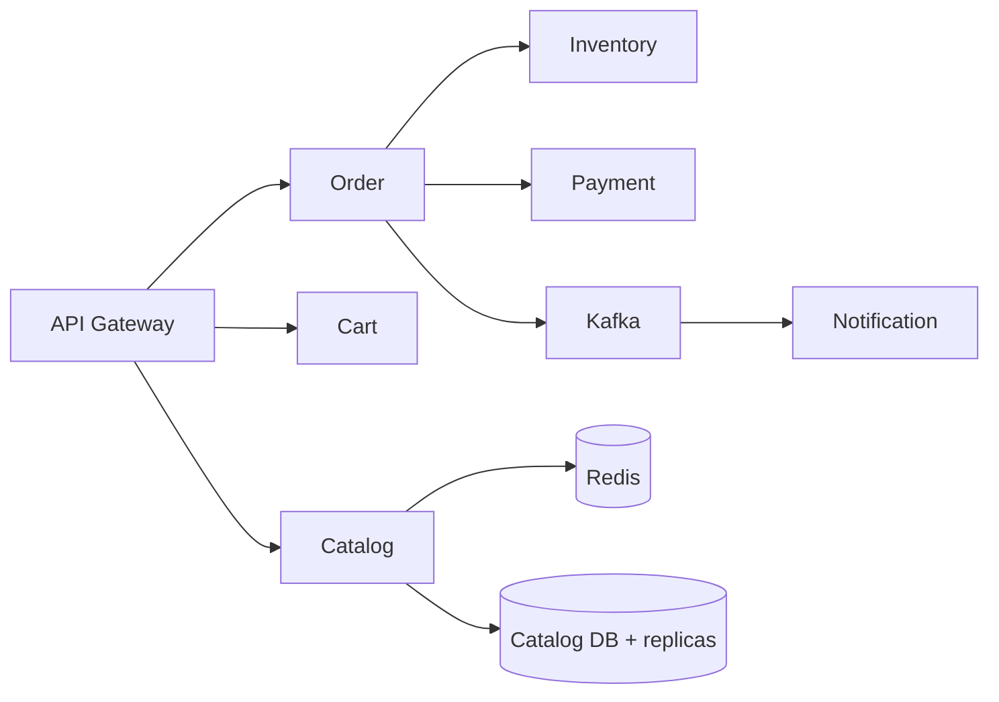
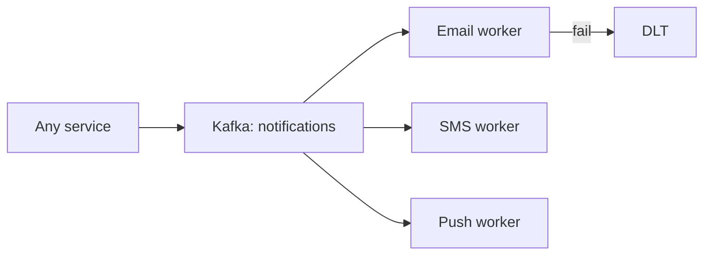
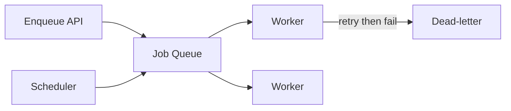

# More System Designs (3–10)

Each design follows the same framework: **requirements → APIs → data model →
architecture → scaling → caching → messaging → failures → trade-offs.**

<ProgressTracker id="sd-more-designs" />

## 3. E-commerce Backend

**Requirements:** browse catalog, cart, checkout, orders, payments, inventory.
Read-heavy catalog; strongly consistent inventory and payments.

**Services:** Catalog, Cart, Order, Payment, Inventory, Notification.

**Key decisions:** catalog cached in Redis + read replicas; inventory decrement uses
**pessimistic locking** or atomic `UPDATE ... WHERE stock >= qty`; checkout emits an
event; notifications/emails are async. Use the **saga** pattern to coordinate
order → payment → inventory across services (see [Patterns](/docs/patterns/)).

## 4. Order Management System

**Requirements:** track an order through a state machine (CREATED → PAID → SHIPPED →
DELIVERED / CANCELLED); reliable status updates; auditability.

**Design:** an order state machine with explicit allowed transitions; every
transition writes an **audit/event log**; downstream systems subscribe to status
events via Kafka. Use the **outbox pattern** so the DB write and event publish are
atomic.

<Important>
Model order status as an explicit state machine with validated transitions. Free-form
status strings lead to impossible states (delivered-then-paid). Store transitions as
append-only events for a full audit trail.
</Important>

## 5. Notification System

**Requirements:** send email/SMS/push; multiple channels; retries; don't block the
caller; dedupe.

**Design:** producers publish `NotificationRequested` to Kafka; per-channel workers
consume, call providers, and retry with backoff; failures go to a **dead-letter
topic**. Idempotency keys prevent duplicate sends. Template + user-preference service
decides channel.

## 6. File Upload Service

**Requirements:** upload/download large files; scalable storage; secure access.

**Design:** store files in **object storage (S3)**, metadata in a DB. Clients upload
directly to S3 via **pre-signed URLs** (the app never proxies bytes). Large files use
**multipart upload**. Serve downloads via CDN + pre-signed, time-limited URLs.

<Backend>
Never stream large uploads through your app servers — issue a pre-signed S3 URL and
let the client upload directly. Your service only stores metadata (owner, size,
content-type, key). This keeps app instances stateless and cheap to scale.
</Backend>

## 7. Payment System

**Requirements:** charge reliably, exactly once, auditable, consistent.

**Design:** **idempotency keys** on every charge request (a retry must not double
charge); a ledger of immutable transactions (double-entry); integrate a payment
provider; use the **outbox pattern** to publish payment events atomically with the DB
write. Strong consistency and reconciliation jobs are mandatory.

<Warning>
Payments must be **idempotent** and **auditable**. Store an idempotency key per
attempt and return the original result on retry. Never delete/mutate ledger rows —
append reversals instead.
</Warning>

## 8. Social Media Feed

**Requirements:** generate a personalized timeline; very read-heavy; fast.

**Design — fan-out trade-off:**
- **Fan-out on write** (push): when a user posts, write it into all followers' feed
  caches. Fast reads, expensive for celebrities with millions of followers.
- **Fan-out on read** (pull): build the feed at read time from followees. Cheap
  writes, slower reads.
- **Hybrid:** push for normal users, pull for celebrities. This is what large
  platforms actually do.

Feeds are precomputed in Redis; use **keyset pagination** (not OFFSET). Eventual
consistency is acceptable — a post appearing a second late is fine.

## 9. Ride Booking System

**Requirements:** match riders to nearby drivers in real time; live location.

**Design:** drivers publish location frequently; a **geospatial index** (Redis
`GEO`, or geohashing/quadtrees) finds nearby drivers; a matching service assigns and
locks a driver (distributed lock to avoid double-assignment); WebSockets push live
updates. Trip state is a state machine; events flow through Kafka for billing and
analytics.

## 10. Job / Task Processing System

**Requirements:** schedule and run background jobs reliably; retries; at-least-once;
visibility.

**Design:** a durable queue (Kafka or a DB-backed queue); workers pull jobs, run them
**idempotently**, and ack on success; failures retry with backoff then move to a DLT;
a scheduler enqueues delayed/cron jobs. Track job status for observability.

## Cross-cutting lessons

| Concern | Recurring answer |
| --- | --- |
| Read-heavy | Cache + read replicas + CDN |
| Write-heavy | Sharding, queues, async |
| Cross-service consistency | Saga + outbox + idempotency |
| Reliability | Retries, DLTs, circuit breakers |
| Big files | Object storage + pre-signed URLs |
| Real-time | WebSockets + geospatial/precomputed indexes |

## Things You Should Know

### 🔴 Must Know
- Async + queues decouple and absorb spikes.
- Idempotency is mandatory for payments, jobs, and notifications.
- Cache + replicas for reads; sharding for writes.

### 🟡 Good to Know
- Feed fan-out on write vs read (and hybrid).
- Saga and outbox for distributed consistency.

### 🟢 Nice to Know
- Geospatial indexing for proximity search.
- Double-entry ledgers for payments.
