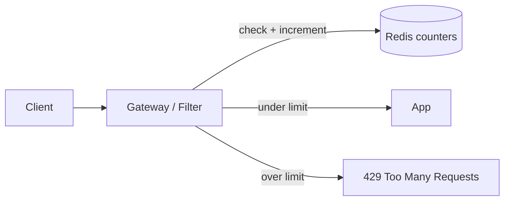

# Design a Rate Limiter

<ProgressTracker id="sd-rate-limiter" />

## Requirements

**Functional:** limit each client to N requests per time window; return `429 Too
Many Requests` with a `Retry-After` header when exceeded.

**Non-functional:** low latency (it's on every request), accurate, works across
many app instances (distributed), fails open or closed by policy.

## Where it lives

At the API gateway (protects everything) or in-app (fine-grained per endpoint).
State must be **shared** across instances — hence Redis, not in-memory counters.



## Algorithms

| Algorithm | Idea | Pros / cons |
| --- | --- | --- |
| **Fixed window** | Count per clock window (e.g. per minute) | Simple; bursty at window edges |
| **Sliding window log** | Store timestamps, count those in the last window | Accurate; more memory |
| **Sliding window counter** | Weighted blend of current + previous window | Good accuracy, cheap |
| **Token bucket** | Tokens refill at a rate; each request spends one | Allows bursts up to bucket size; industry standard |
| **Leaky bucket** | Requests drain at a fixed rate | Smooths output; queues |

## Token bucket in Redis

Each client has a bucket with a capacity and refill rate. This must be **atomic** —
use a Lua script so check-and-update can't race across instances.

```lua
-- KEYS[1] = bucket key ; ARGV: capacity, refill_per_sec, now, requested
local bucket = redis.call('HMGET', KEYS[1], 'tokens', 'ts')
local tokens = tonumber(bucket[1]) or tonumber(ARGV[1])
local ts     = tonumber(bucket[2]) or tonumber(ARGV[3])
local delta  = math.max(0, tonumber(ARGV[3]) - ts)
tokens = math.min(tonumber(ARGV[1]), tokens + delta * tonumber(ARGV[2]))
if tokens < tonumber(ARGV[4]) then
  return 0                         -- rejected
end
tokens = tokens - tonumber(ARGV[4])
redis.call('HMSET', KEYS[1], 'tokens', tokens, 'ts', ARGV[3])
redis.call('EXPIRE', KEYS[1], 60)
return 1                           -- allowed
```

Simpler fixed-window version in Java:

```java
String key = "rate:" + clientId + ":" + (epochSecond / 60);
Long count = redis.opsForValue().increment(key);
if (count == 1) redis.expire(key, Duration.ofMinutes(1));
if (count > limitPerMinute) {
    throw new TooManyRequestsException(retryAfterSeconds());
}
```

<Important>
The check and increment must be **atomic**. Two instances doing `GET` then `INCR`
separately can both pass a client over the limit. Use `INCR` (atomic) or a Lua
script that reads and writes in one round trip.
</Important>

## Response

```http
HTTP/1.1 429 Too Many Requests
Retry-After: 30
X-RateLimit-Limit: 100
X-RateLimit-Remaining: 0
```

## Failure scenarios

- **Redis down** → decide policy: **fail open** (allow traffic, prioritize
  availability) or **fail closed** (reject, prioritize protection). Most APIs fail
  open with local fallback limits.
- **Clock skew** across nodes → use Redis server time or the gateway's time
  consistently.

## Trade-offs

| Decision | Trade-off |
| --- | --- |
| Fixed vs sliding window | Simplicity vs edge-burst accuracy |
| Token bucket | Allows bursts (usually desirable) vs strict smoothing |
| Fail open vs closed | Availability vs protection |

## Things You Should Know

### 🔴 Must Know
- Token bucket and sliding window; why counters must be atomic.
- Return 429 + Retry-After; shared state in Redis.

### 🟡 Good to Know
- Fail-open vs fail-closed policy.
- Per-user, per-IP, and per-endpoint keys.

### 🟢 Nice to Know
- Lua scripts for atomic multi-step logic.
- Distributed token refill and clock-skew handling.
