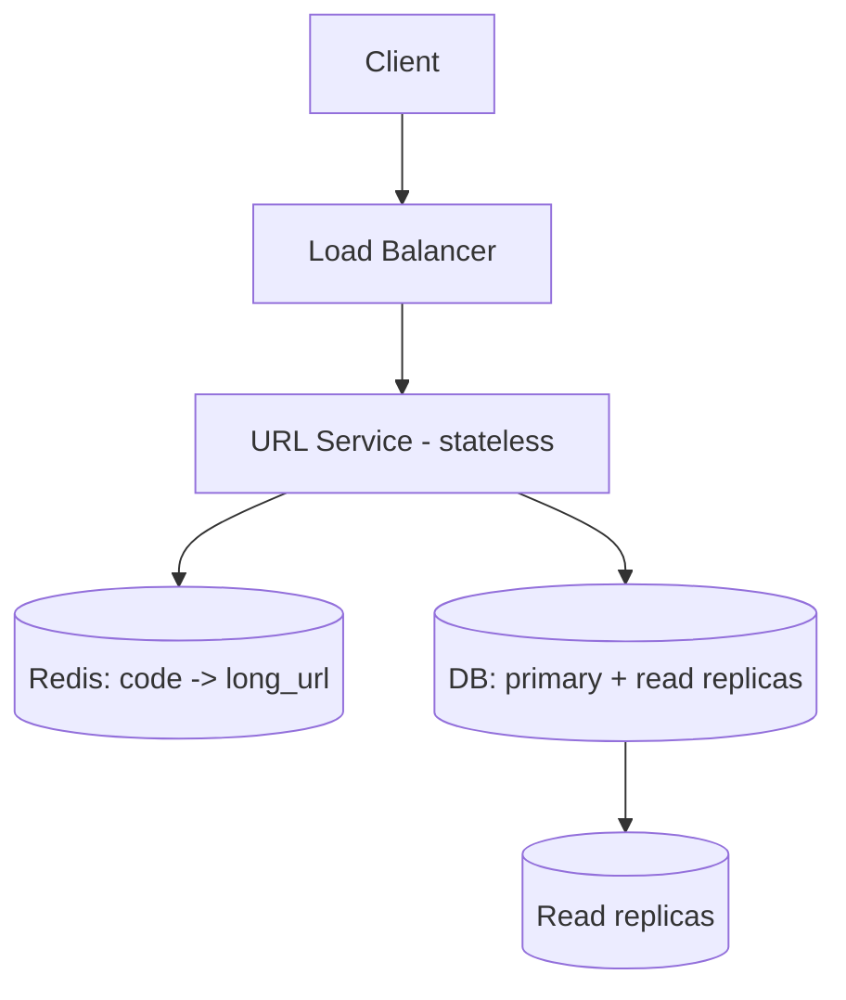

# Design a URL Shortener

<ProgressTracker id="sd-url-shortener" />

## Requirements

**Functional:** shorten a long URL to a short code; redirect a short code to the
original; optional custom alias and expiry.

**Non-functional:** very read-heavy (redirects ≫ creates), low-latency redirects,
highly available, short codes are permanent.

**Estimation:** say 100M new URLs/month ≈ 40 writes/s; reads 100× that ≈ 4,000/s.
Over 5 years ≈ 6B URLs → a 7-character base62 code (62⁷ ≈ 3.5 trillion) is plenty.

## APIs

```http
POST /api/urls           { "url": "https://...", "alias": "optional" }  -> 201 { "code": "aZ3x9Q" }
GET  /{code}             -> 301 Location: https://original...
```

## Data model

```sql
CREATE TABLE urls (
  code        VARCHAR(10) PRIMARY KEY,   -- base62 short code
  long_url    TEXT NOT NULL,
  created_at  TIMESTAMPTZ NOT NULL DEFAULT now(),
  expires_at  TIMESTAMPTZ
);
```

## Key generation

Two solid approaches:

1. **Counter + base62:** a global monotonic counter (or a range-allocated one per
   node) encoded to base62. Guarantees uniqueness, no collisions.
2. **Random + check:** generate a random 7-char code, retry on the rare collision
   (unique constraint catches it).

<Interview>
Prefer the **counter/range** approach for guaranteed uniqueness without collision
checks. A central sequence is a bottleneck, so hand each app node a **range** of ids
(e.g. 1M at a time) to encode locally — no per-request coordination.
</Interview>

## Architecture



## Redirect flow (the hot path)

```java
@GetMapping("/{code}")
ResponseEntity<Void> redirect(@PathVariable String code) {
    String url = cache.get(code);                 // 1. cache first
    if (url == null) {
        url = repository.findById(code)            // 2. DB on miss
            .map(Url::getLongUrl)
            .orElseThrow(() -> new NotFoundException(code));
        cache.set(code, url, Duration.ofHours(24)); // 3. populate cache
    }
    return ResponseEntity.status(HttpStatus.MOVED_PERMANENTLY)
        .location(URI.create(url)).build();
}
```

## Scaling strategy

- **Stateless app** behind a load balancer → scale horizontally.
- **Read-heavy** → aggressive Redis caching (near-100% hit rate for popular links)
  plus DB **read replicas**.
- **Storage** → the table is huge but simple; shard by `code` (consistent hashing)
  if a single DB can't hold it.
- **CDN / edge** can cache 301s for the hottest links.

## Caching

Cache `code → long_url` with a TTL. Redirects rarely change, so hit rates are
excellent. Use `301` (permanent, cacheable by browsers) for stable links, `302` if
you need to count every click server-side.

## Failure scenarios

- **Cache down** → fall back to DB (higher latency, still correct).
- **DB primary down** → reads continue from replicas; creates pause until failover.
- **Hot key** → CDN/edge caching absorbs traffic spikes.

## Trade-offs

| Decision | Trade-off |
| --- | --- |
| Counter vs random codes | Uniqueness guarantee vs simpler stateless generation |
| 301 vs 302 | Browser caching (fast, fewer analytics) vs full click tracking |
| SQL vs NoSQL | Simple + transactional vs easier horizontal scale |

## Things You Should Know

### 🔴 Must Know
- Read-heavy → cache + replicas; stateless app + LB.
- Base62 code sizing and generation approaches.

### 🟡 Good to Know
- Range-allocated counters to avoid a central bottleneck.
- 301 vs 302 implications.

### 🟢 Nice to Know
- Click analytics via an async event pipeline (Kafka).
