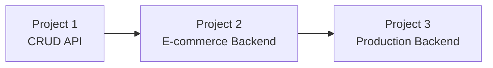

# Backend Projects

Reading isn't enough — you become job-ready by building. These three projects
escalate in difficulty and together exercise every topic in this curriculum.

<ProgressTracker id="projects-overview" />

## The progression

  <Link className="jbm-card" to="/docs/projects/project-1-crud-api">
    
🟢

    <h3>1. User Management API</h3>
    
Spring Boot + PostgreSQL + JPA + REST. Master the layered architecture.

  </Link>
  <Link className="jbm-card" to="/docs/projects/project-2-ecommerce">
    
🟡

    <h3>2. E-commerce Backend</h3>
    
Users, products, cart, orders, payments, JWT auth.

  </Link>
  <Link className="jbm-card" to="/docs/projects/project-3-production">
    
🔴

    <h3>3. Production Backend</h3>
    
Redis, Kafka, Docker, testing, logging, metrics, rate limiting.

  </Link>

<Tip>
Don't just copy the code — build each project yourself, commit it to GitHub, write a
README with the architecture diagram, and be ready to explain every decision. A
polished repo is the strongest interview asset you can bring.
</Tip>

## What each project proves

| Project | You can... |
| --- | --- |
| 1. CRUD API | Structure a Spring Boot app, expose validated REST endpoints, persist with JPA |
| 2. E-commerce | Model a domain, secure it with JWT, coordinate multi-entity transactions |
| 3. Production | Cache, message, containerize, test, observe, and harden a real service |

## Things You Should Know

### 🔴 Must Know
- Layered architecture, DTOs, validation, error handling.
- JWT authentication and role-based authorization.

### 🟡 Good to Know
- Caching, async messaging, and transactions across entities.

### 🟢 Nice to Know
- Observability, resilience, and containerized deployment.
