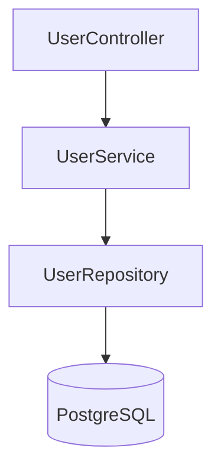

# Project 1: User Management API

<ProgressTracker id="project-1" />

## Goal

Build a production-shaped CRUD API for managing users. Master the
Controller → Service → Repository layering, DTOs, validation, and error handling.

**Stack:** Java 21, Spring Boot, PostgreSQL, Spring Data JPA, Bean Validation.

## Requirements

- Create, read (single + paginated list), update, and delete users.
- Validate input; unique email; consistent error responses.
- Never expose the JPA entity directly — use DTOs.

## Data model

```sql
CREATE TABLE users (
  id         BIGSERIAL PRIMARY KEY,
  name       VARCHAR(100) NOT NULL,
  email      VARCHAR(255) NOT NULL UNIQUE,
  created_at TIMESTAMPTZ NOT NULL DEFAULT now()
);
```

## Layers



### Entity & DTOs

```java
@Entity @Table(name = "users")
public class User {
    @Id @GeneratedValue(strategy = GenerationType.IDENTITY)
    private Long id;
    @Column(nullable = false) private String name;
    @Column(nullable = false, unique = true) private String email;
    @Column(name = "created_at", updatable = false) private Instant createdAt = Instant.now();
    // getters/setters/constructors omitted
}

public record CreateUserRequest(@NotBlank String name, @Email @NotBlank String email) {}
public record UpdateUserRequest(@NotBlank String name) {}
public record UserResponse(Long id, String name, String email, Instant createdAt) {}
```

### Repository

```java
public interface UserRepository extends JpaRepository<User, Long> {
    boolean existsByEmail(String email);
}
```

### Service

```java
@Service
@Transactional
public class UserService {
    private final UserRepository repo;
    public UserService(UserRepository repo) { this.repo = repo; }

    public UserResponse create(CreateUserRequest req) {
        if (repo.existsByEmail(req.email()))
            throw new EmailAlreadyUsedException(req.email());
        User saved = repo.save(new User(req.name(), req.email()));
        return toResponse(saved);
    }

    @Transactional(readOnly = true)
    public Page<UserResponse> list(Pageable pageable) {
        return repo.findAll(pageable).map(this::toResponse);
    }

    @Transactional(readOnly = true)
    public UserResponse get(Long id) {
        return repo.findById(id).map(this::toResponse)
            .orElseThrow(() -> new UserNotFoundException(id));
    }

    public UserResponse update(Long id, UpdateUserRequest req) {
        User user = repo.findById(id).orElseThrow(() -> new UserNotFoundException(id));
        user.setName(req.name());              // dirty checking flushes on commit
        return toResponse(user);
    }

    public void delete(Long id) {
        if (!repo.existsById(id)) throw new UserNotFoundException(id);
        repo.deleteById(id);
    }

    private UserResponse toResponse(User u) {
        return new UserResponse(u.getId(), u.getName(), u.getEmail(), u.getCreatedAt());
    }
}
```

### Controller

```java
@RestController
@RequestMapping("/api/users")
public class UserController {
    private final UserService service;
    public UserController(UserService service) { this.service = service; }

    @PostMapping
    public ResponseEntity<UserResponse> create(@Valid @RequestBody CreateUserRequest req) {
        UserResponse created = service.create(req);
        return ResponseEntity.created(URI.create("/api/users/" + created.id())).body(created);
    }

    @GetMapping("/{id}")
    public UserResponse get(@PathVariable Long id) { return service.get(id); }

    @GetMapping
    public Page<UserResponse> list(@RequestParam(defaultValue = "0") int page,
                                   @RequestParam(defaultValue = "20") int size) {
        return service.list(PageRequest.of(page, size, Sort.by("id").ascending()));
    }

    @PutMapping("/{id}")
    public UserResponse update(@PathVariable Long id, @Valid @RequestBody UpdateUserRequest req) {
        return service.update(id, req);
    }

    @DeleteMapping("/{id}")
    @ResponseStatus(HttpStatus.NO_CONTENT)
    public void delete(@PathVariable Long id) { service.delete(id); }
}
```

### Global error handling

Reuse the `@RestControllerAdvice` from [Exception Handling](/docs/exceptions/) so
`UserNotFoundException` → 404, `EmailAlreadyUsedException` → 409, validation → 400.

## Definition of done

- [ ] All five endpoints work and return correct status codes.
- [ ] Validation rejects blank names and bad emails (400).
- [ ] Duplicate email returns 409; missing user returns 404.
- [ ] A `@WebMvcTest` for the controller and a `@DataJpaTest` for the repository pass.
- [ ] README with a run command and the architecture diagram.

## Stretch goals

- Add pagination metadata and sorting by query param.
- Add springdoc-openapi and view Swagger UI.
- Containerize with the Dockerfile from [Docker](/docs/docker/).

## Things You Should Know

### 🔴 Must Know
- Clean layering, DTOs at the boundary, correct status codes.
- Validation + centralized error handling.

### 🟡 Good to Know
- Pagination/sorting; unique-constraint conflict handling.

### 🟢 Nice to Know
- OpenAPI docs; containerized run.
