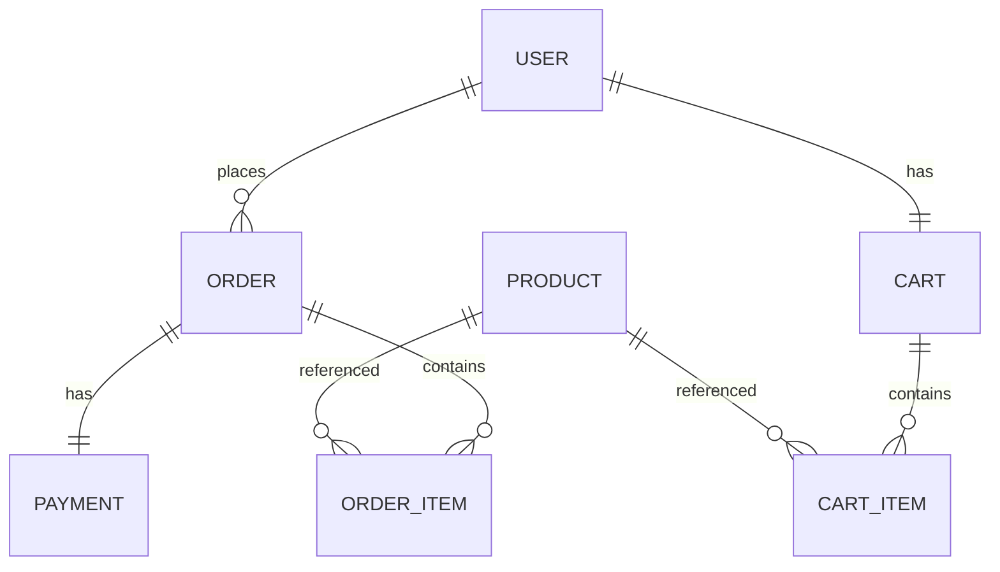

# Project 2: E-commerce Backend

<ProgressTracker id="project-2" />

## Goal

Model a real domain and secure it. This project adds authentication, authorization,
and multi-entity transactions on top of Project 1's foundations.

**Stack:** Spring Boot, PostgreSQL, Spring Data JPA, Spring Security + JWT.

## Domain



## Features

| Module | Endpoints (sample) |
| --- | --- |
| Auth | `POST /api/auth/register`, `POST /api/auth/login` |
| Products | `GET /api/products`, `POST /api/products` (ADMIN) |
| Cart | `GET /api/cart`, `POST /api/cart/items`, `DELETE /api/cart/items/{id}` |
| Orders | `POST /api/orders` (checkout), `GET /api/orders` |
| Payments | `POST /api/orders/{id}/pay` |

## Security

Implement JWT auth from [Spring Security → JWT](/docs/security/jwt-authentication/):
register hashes the password with BCrypt; login returns an access token; a filter
authenticates each request. Product writes require `ROLE_ADMIN`.

```java
@PostMapping("/api/products")
@PreAuthorize("hasRole('ADMIN')")
public ProductResponse create(@Valid @RequestBody CreateProductRequest req) { ... }
```

## Checkout: a multi-entity transaction

The interesting part. Checkout must be atomic: create the order, snapshot prices,
decrement stock, and clear the cart — all or nothing.

```java
@Service
public class CheckoutService {
    private final CartRepository carts;
    private final ProductRepository products;
    private final OrderRepository orders;

    public CheckoutService(CartRepository carts, ProductRepository products, OrderRepository orders) {
        this.carts = carts; this.products = products; this.orders = orders;
    }

    @Transactional
    public OrderResponse checkout(Long userId) {
        Cart cart = carts.findByUserId(userId).orElseThrow(EmptyCartException::new);
        if (cart.getItems().isEmpty()) throw new EmptyCartException();

        Order order = new Order(userId);
        for (CartItem item : cart.getItems()) {
            Product p = products.findById(item.getProductId()).orElseThrow();
            // Atomic conditional decrement prevents overselling under concurrency
            int updated = products.decrementStock(p.getId(), item.getQuantity());
            if (updated == 0) throw new OutOfStockException(p.getId());
            order.addItem(p.getId(), item.getQuantity(), p.getPrice());  // snapshot price
        }
        Order saved = orders.save(order);
        cart.clear();                       // dirty-checked, flushed on commit
        return OrderMapper.toResponse(saved);
    }
}
```

```java
// Repository: atomic stock decrement (avoids read-modify-write race)
@Modifying
@Query("UPDATE Product p SET p.stock = p.stock - :qty WHERE p.id = :id AND p.stock >= :qty")
int decrementStock(@Param("id") Long id, @Param("qty") int qty);
```

<Important>
Snapshot the price into the order line at checkout. If you reference the live product
price, historical orders change when prices change. Orders must record what the
customer actually paid.
</Important>

<Warning>
Decrement stock atomically (`UPDATE ... WHERE stock >= qty`) or with a lock. A naive
read-check-write lets two concurrent checkouts both pass the stock check and oversell.
</Warning>

## Definition of done

- [ ] Register/login issue and validate JWTs; protected endpoints require auth.
- [ ] Only ADMIN can create/update products.
- [ ] Checkout is transactional: stock decremented, cart cleared, prices snapshotted.
- [ ] Overselling is impossible under concurrent checkouts.
- [ ] Service + controller tests cover the happy path and key failures.

## Stretch goals

- Order status state machine (CREATED → PAID → SHIPPED).
- Integrate a fake payment provider with idempotency keys.
- Emit an `OrderPlaced` event (in-memory now, Kafka in Project 3).

## Things You Should Know

### 🔴 Must Know
- JWT auth + role-based authorization.
- Transactional multi-entity operations; atomic stock updates.
- Price snapshotting.

### 🟡 Good to Know
- Preventing oversell under concurrency.
- Order state machine.

### 🟢 Nice to Know
- Idempotent payments; domain events.
