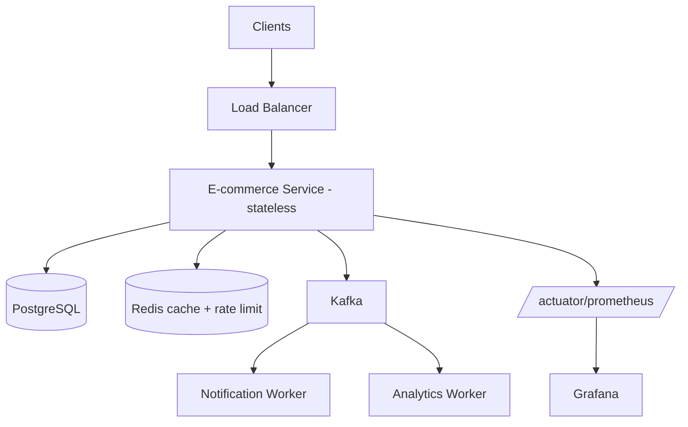

# Project 3: Production-Grade Backend

<ProgressTracker id="project-3" />

## Goal

Take Project 2 and make it production-ready: cache it, make it event-driven,
containerize it, test it thoroughly, and make it observable and resilient.

**Stack:** Spring Boot, PostgreSQL, Redis, Kafka, Docker Compose, JWT, JUnit 5 +
Testcontainers, Micrometer/Actuator, Resilience4j, Flyway.

## Target architecture



## Feature checklist

### Caching (Redis)
- Cache the product catalog with `@Cacheable`; evict on product updates.
- Use cache-aside for hot product reads. See [Redis & Caching](/docs/redis-caching/).

### Messaging (Kafka)
- On checkout, publish an `OrderPlaced` event.
- A **Notification worker** consumes it and "sends" a confirmation (log/email stub).
- Consumers are **idempotent**; failures go to a dead-letter topic.

```java
@KafkaListener(topics = "orders", groupId = "notifications")
public void onOrderPlaced(OrderPlaced event) {
    if (alreadyProcessed(event.orderId())) return;   // idempotent
    emailService.sendConfirmation(event);
    markProcessed(event.orderId());
}
```

### Rate limiting
- Limit login attempts and checkout per user with a Redis counter; return `429`.

### Resilience
- Wrap the payment-provider call in a Resilience4j **circuit breaker + retry +
  timeout** with a fallback. See [Production Backend](/docs/production/).

### Observability
- Expose `/actuator/health`, `/actuator/prometheus`.
- Structured JSON logs with a correlation id per request (MDC filter).
- Custom metrics: `orders.placed`, `checkout.duration`.

### Migrations
- Manage schema with **Flyway** (`V1__init.sql`, `V2__add_payments.sql`). Set
  `spring.jpa.hibernate.ddl-auto=validate`.

### Testing
- Unit tests (Mockito) for services.
- `@WebMvcTest` for controllers, `@DataJpaTest` for repositories.
- **Testcontainers** integration test running real Postgres + Kafka for the
  checkout → event → notification flow.

## Docker Compose

Bring the whole system up with one command using the Compose file from
[Docker](/docs/docker/) — app + Postgres + Redis + Kafka.

```bash
docker compose up -d
curl -s localhost:8080/actuator/health
```

## Definition of done

- [ ] Catalog reads are cached and invalidated on write.
- [ ] Checkout publishes an event; notification worker consumes idempotently.
- [ ] Circuit breaker protects the payment call and has a fallback.
- [ ] Rate limiting returns 429 with `Retry-After`.
- [ ] Health, metrics, and correlation-id logging are in place.
- [ ] Flyway manages schema; `ddl-auto=validate`.
- [ ] Testcontainers integration test passes end to end.
- [ ] `docker compose up` starts the full stack.
- [ ] README documents the architecture, decisions, and how to run.

## Interview narrative

<Backend>
This project is your strongest talking point. Be ready to whiteboard the
architecture, explain why checkout is transactional, how you prevent oversell and
duplicate notifications, how the circuit breaker degrades gracefully, and how you'd
scale each component. That story demonstrates end-to-end backend competence.
</Backend>

## Things You Should Know

### 🔴 Must Know
- Caching, async events, idempotency, resilience, observability wired together.
- Migrations with Flyway; realistic integration testing.

### 🟡 Good to Know
- Dead-letter topics; circuit-breaker fallbacks; rate limiting.

### 🟢 Nice to Know
- Horizontal scaling story; outbox pattern for the event publish.
