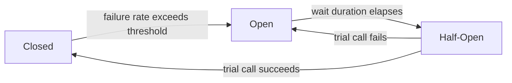
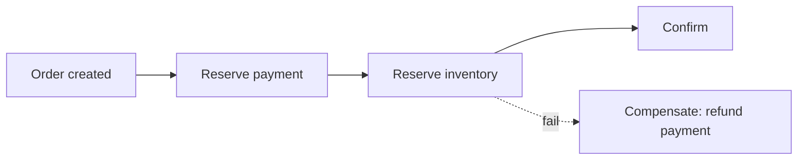
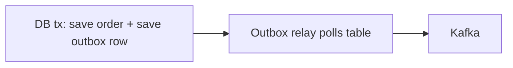

# Backend Patterns

Patterns are shared vocabulary for recurring problems. They're not rules to apply
everywhere — each one trades simplicity for some other property (flexibility,
testability, resilience). The skill isn't memorizing the GoF catalog; it's
recognizing the problem shape and knowing which trade-off you're signing up for.

These are the patterns that actually show up in Java backends — architecture
patterns, classic GoF patterns, and distributed-systems patterns — each with the
problem it solves and a concrete example.

<ProgressTracker id="patterns-overview" />

## Table of Contents

- [Architecture patterns](#architecture-patterns)
- [Creational: Factory, Builder, Singleton](#creational-factory-builder-singleton)
- [Structural: Adapter, Decorator, Proxy](#structural-adapter-decorator-proxy)
- [Behavioral: Strategy, Observer, Template, Chain, Command](#behavioral-strategy-observer-template-chain-command)
- [Distributed patterns: Circuit Breaker, Retry, Saga, Outbox, CQRS](#distributed-patterns)
- [Choosing between look-alike patterns](#choosing-between-look-alike-patterns)
- [Most Asked Interview Questions](#most-asked-interview-questions)
- [Things You Should Know](#things-you-should-know)

## Architecture patterns

**Layered architecture** (Controller → Service → Repository) with the **Repository**,
**Service**, and **DTO** patterns is the backbone of every Spring app. The point of
the layering is dependency direction: each layer depends only on the one below it
through an interface, so you can swap implementations (a fake repository in tests,
a different persistence technology in prod) without touching the layers above.

```java
// DTO: decouple the API contract from the entity.
// Entities carry persistence concerns (JPA annotations, lazy fields);
// DTOs carry exactly what the API contract promises — nothing more.
public record OrderDto(Long id, String status, BigDecimal total) {}

// Repository: abstract data access behind an interface.
// The Service layer depends on this interface, not on JPA/Hibernate directly.
public interface OrderRepository extends JpaRepository<Order, Long> {
    List<Order> findByCustomerId(Long customerId);
}

// Service: business logic + transaction boundaries, depends on abstractions.
@Service
class OrderService {
    private final OrderRepository repo;

    OrderService(OrderRepository repo) { this.repo = repo; }

    @Transactional
    public OrderDto place(Long customerId, List<LineItem> items) {
        Order order = new Order(customerId, items);
        repo.save(order);
        return new OrderDto(order.getId(), order.getStatus(), order.getTotal());
    }
}

// Controller: HTTP concerns only — no business logic here.
@RestController
@RequestMapping("/orders")
class OrderController {
    private final OrderService service;
    OrderController(OrderService service) { this.service = service; }

    @PostMapping
    OrderDto create(@RequestBody CreateOrderRequest req) {
        return service.place(req.customerId(), req.items());
    }
}
```

**Dependency Injection** (the container supplies collaborators instead of a class
constructing its own dependencies) underpins all of it — it's what makes swapping
`OrderRepository` for a test double possible without editing `OrderService`. See
[Spring Core](/docs/spring-core/).

## Creational: Factory, Builder, Singleton

Creational patterns exist because `new SomeClass(...)` is sometimes the wrong
level of abstraction — the *caller* shouldn't need to know which concrete class
to instantiate, or the construction itself is complex enough to deserve its own step.

### Factory

**Intent:** centralize object creation behind a method so callers depend on an
interface, not a concrete class. Useful whenever the concrete type is chosen by
some runtime condition (a type code, config, request payload).

```java
interface PaymentProcessor { void charge(BigDecimal amount); }

class PaymentProcessorFactory {
    public PaymentProcessor create(PaymentMethod method) {
        return switch (method) {
            case CARD -> new CardProcessor();
            case UPI  -> new UpiProcessor();
        };
    }
}
```

In Spring, this is often replaced entirely by injecting a `Map<String, PaymentProcessor>`
(Spring auto-populates it from all beans of that type, keyed by bean name) and
looking up by key — no factory class needed.

### Builder

**Intent:** construct complex or immutable objects step by step, especially when
there are many optional fields — avoids "telescoping constructors"
(`new Order(id, null, null, note, null, true)`).

```java
public class Order {
    private final Long customerId;
    private final List<LineItem> items;
    private final String note;

    private Order(Builder b) {
        this.customerId = b.customerId;
        this.items = List.copyOf(b.items);
        this.note = b.note;
    }

    public static Builder builder() { return new Builder(); }

    public static class Builder {
        private Long customerId;
        private final List<LineItem> items = new ArrayList<>();
        private String note = "";

        public Builder customerId(Long id) { this.customerId = id; return this; }
        public Builder addItem(Product p, int qty) { items.add(new LineItem(p, qty)); return this; }
        public Builder note(String note) { this.note = note; return this; }
        public Order build() {
            if (customerId == null) throw new IllegalStateException("customerId required");
            return new Order(this);
        }
    }
}

Order order = Order.builder()
    .customerId(42L)
    .addItem(product, 2)
    .note("gift wrap")
    .build();
```

A Java `record` covers the common "just an immutable data holder" case with less
ceremony; reach for a Builder when there are several optional fields, invariants
to validate at construction, or a fluent multi-step assembly reads better than a
long constructor.

### Singleton

**Intent:** guarantee exactly one instance of a class exists application-wide.
In Spring you rarely hand-roll this: a `@Service`/`@Component` bean is, by
default scope, a container-managed singleton — created once, wired everywhere it's
`@Autowired`.

```java
@Service
class ConfigCache { /* one instance for the whole app, managed by Spring */ }
```

<Warning>
Hand-written singletons are easy to get wrong — the classic double-checked-locking
implementation is a common source of subtle concurrency bugs. Prefer a
Spring-managed singleton bean. If you must code one outside a DI container, an enum
with a single value is the safest option (serialization-safe, thread-safe by the JVM's
class-loading guarantees):

```java
public enum AppConfig {
    INSTANCE;
    private final Properties props = loadProperties();
    public String get(String key) { return props.getProperty(key); }
}
```
</Warning>

## Structural: Adapter, Decorator, Proxy

Structural patterns are about composing objects/interfaces to get a shape you need
without changing the pieces you're composing.

### Adapter

**Intent:** make an incompatible interface fit the one your code expects, without
modifying the incompatible class (often because you don't own it — it's a
third-party SDK).

```java
// Your domain's interface
interface PaymentGateway { PaymentResult charge(BigDecimal amount, String cardToken); }

// Third-party SDK you don't control, with an incompatible shape
class StripeSdkClient {
    StripeChargeResponse createCharge(long amountCents, String token, String currency) { /* ... */ return null; }
}

// Adapter: translates between the two shapes
class StripeAdapter implements PaymentGateway {
    private final StripeSdkClient stripe;
    StripeAdapter(StripeSdkClient stripe) { this.stripe = stripe; }

    @Override
    public PaymentResult charge(BigDecimal amount, String cardToken) {
        long cents = amount.movePointRight(2).longValueExact();
        StripeChargeResponse resp = stripe.createCharge(cents, cardToken, "usd");
        return new PaymentResult(resp.isSuccess(), resp.getId());
    }
}
```

The rest of your app codes against `PaymentGateway`; swapping Stripe for another
provider means writing a new adapter, not touching business logic.

### Decorator

**Intent:** attach new behavior to an object dynamically by wrapping it, without
altering its class or affecting other instances. The wrapper implements the same
interface as what it wraps, so callers can't tell the difference.

```java
interface ProductRepo { Product find(Long id); }

class CachingProductRepo implements ProductRepo {
    private final ProductRepo delegate;
    private final Cache<Long, Product> cache;

    CachingProductRepo(ProductRepo delegate, Cache<Long, Product> cache) {
        this.delegate = delegate;
        this.cache = cache;
    }

    @Override
    public Product find(Long id) {
        return cache.get(id, () -> delegate.find(id)); // add caching, same interface
    }
}

// Decorators compose: logging wraps caching wraps the real repo
ProductRepo repo = new LoggingProductRepo(new CachingProductRepo(new JpaProductRepo(), cache));
```

### Proxy

**Intent:** stand in for another object to control or add behavior around access
to it (lazy loading, access control, remote calls, cross-cutting concerns) — the
proxy implements the same interface as the real subject, and the caller is
typically unaware a proxy is involved at all.

This is exactly how Spring implements `@Transactional` and `@Cacheable`: Spring
wraps your bean in a dynamically-generated proxy at startup; calls to your
`@Transactional` method actually hit the proxy first, which opens/commits a
transaction around a call to your real method (see
[AOP](/docs/spring-core/)).

```java
@Service
class OrderService {
    @Transactional
    public void place(Order order) { /* your business logic */ }
}
// What actually runs: proxy.place(order) ->
//   conn.setAutoCommit(false); try { real.place(order); conn.commit(); } catch (e) { conn.rollback(); }
```

<Interview>
**Decorator vs Proxy** — they look identical in code (both wrap the same interface).
The difference is intent: Decorator is about *adding* behavior/responsibilities that
the client explicitly opts into by composing wrappers; Proxy is about *controlling
access* to the underlying object, often transparently, without the client choosing
to compose anything.
</Interview>

## Behavioral: Strategy, Observer, Template, Chain, Command

Behavioral patterns are about how objects communicate and how responsibility for
a piece of logic gets distributed or delegated.

### Strategy

**Intent:** swap an algorithm at runtime behind a common interface, so the calling
code doesn't need conditionals over "which algorithm to use."

```java
interface DiscountStrategy { BigDecimal apply(BigDecimal price); }

class PercentageDiscount implements DiscountStrategy {
    private final BigDecimal percent;
    PercentageDiscount(BigDecimal percent) { this.percent = percent; }
    public BigDecimal apply(BigDecimal price) {
        return price.subtract(price.multiply(percent));
    }
}

class NoDiscount implements DiscountStrategy {
    public BigDecimal apply(BigDecimal price) { return price; }
}

@Service
class PricingService {
    BigDecimal priceFor(BigDecimal base, DiscountStrategy strategy) {
        return strategy.apply(base); // caller supplies the strategy; no if/else here
    }
}
```

### Observer

**Intent:** decouple a publisher from its subscribers — the publisher doesn't know
or care who's listening, or how many. Spring's `ApplicationEventPublisher` is
Observer within a single JVM; Kafka is the same pattern at the scale of a
distributed system.

```java
public record OrderPlacedEvent(Long orderId) {}

@Service
class OrderService {
    private final ApplicationEventPublisher publisher;
    OrderService(ApplicationEventPublisher publisher) { this.publisher = publisher; }

    void place(Order order) {
        // ... save order ...
        publisher.publishEvent(new OrderPlacedEvent(order.getId()));
    }
}

@Component
class EmailNotifier {
    @EventListener
    void onOrderPlaced(OrderPlacedEvent e) {
        // send confirmation email — OrderService has no idea this exists
    }
}

@Component
class InventoryUpdater {
    @EventListener
    void onOrderPlaced(OrderPlacedEvent e) {
        // decrement stock — a second, independent listener
    }
}
```

### Template Method

**Intent:** a base class defines the skeleton of an algorithm and defers specific
steps to subclasses, so shared structure isn't duplicated across implementations.

```java
abstract class PaymentProcessor {
    // template method: the skeleton is fixed, steps are overridable
    public final PaymentResult process(BigDecimal amount) {
        validate(amount);
        PaymentResult result = charge(amount);
        logResult(result);
        return result;
    }

    protected void validate(BigDecimal amount) {
        if (amount.signum() <= 0) throw new IllegalArgumentException("amount must be positive");
    }

    protected abstract PaymentResult charge(BigDecimal amount); // subclasses fill this in

    private void logResult(PaymentResult result) { /* shared logging */ }
}

class CardPaymentProcessor extends PaymentProcessor {
    protected PaymentResult charge(BigDecimal amount) { /* card-specific charge logic */ return null; }
}
```

### Chain of Responsibility

**Intent:** pass a request along a chain of handlers until one of them handles it,
without the sender knowing which handler will. The **Spring Security filter chain**
is a textbook example — each `Filter` decides whether to act and whether to call
the next one.

```java
interface RequestHandler {
    void setNext(RequestHandler next);
    void handle(Request request);
}

abstract class BaseHandler implements RequestHandler {
    private RequestHandler next;
    public void setNext(RequestHandler next) { this.next = next; }
    protected void callNext(Request request) {
        if (next != null) next.handle(request);
    }
}

class AuthHandler extends BaseHandler {
    public void handle(Request request) {
        if (!request.isAuthenticated()) throw new UnauthorizedException();
        callNext(request); // pass along the chain
    }
}

class RateLimitHandler extends BaseHandler {
    public void handle(Request request) {
        if (isOverLimit(request)) throw new TooManyRequestsException();
        callNext(request);
    }
    private boolean isOverLimit(Request r) { return false; }
}

// wiring: auth -> rate limit -> ... -> actual handler
AuthHandler chain = new AuthHandler();
RateLimitHandler rateLimit = new RateLimitHandler();
chain.setNext(rateLimit);
```

### Command

**Intent:** encapsulate a request (and everything needed to execute it) as an
object, so it can be queued, logged, retried, or undone independently of the
caller that created it.

```java
interface Command { void execute(); }

class SendEmailCommand implements Command {
    private final String to, body;
    SendEmailCommand(String to, String body) { this.to = to; this.body = body; }
    public void execute() { /* send it */ }
}

// A job queue just stores and later executes Command objects —
// it doesn't need to know anything about email
Queue<Command> jobQueue = new ArrayDeque<>();
jobQueue.add(new SendEmailCommand("user@example.com", "Your order shipped"));

// worker thread
Command job = jobQueue.poll();
if (job != null) job.execute();
```

## Distributed patterns

Essential for microservices — see [Kafka](/docs/kafka-messaging/),
[Production](/docs/production/), and [System Design](/docs/system-design/).

### Circuit Breaker

**Intent:** stop calling a failing dependency instead of piling up slow/failing
requests against it — fail fast, give the dependency room to recover, and retry
occasionally to see if it's healthy again. Three states: **closed** (calls pass
through normally), **open** (calls fail immediately, no network call made), and
**half-open** (a trial call is allowed through to test recovery).



```java
@CircuitBreaker(name = "inventoryService", fallbackMethod = "fallback")
public InventoryStatus checkStock(Long productId) {
    return inventoryClient.check(productId);
}

private InventoryStatus fallback(Long productId, Throwable t) {
    return InventoryStatus.unknown(); // degrade gracefully instead of hanging
}
```
(Using Resilience4j's Spring Boot integration, shown above.)

### Retry

**Intent:** transient failures (a momentary network blip, a brief 503) often
succeed on a second attempt — retry with **exponential backoff** and **jitter** so
retries don't pile onto an already-struggling dependency in lockstep.

```java
@Retry(name = "inventoryService", fallbackMethod = "fallback")
public InventoryStatus checkStock(Long productId) {
    return inventoryClient.check(productId);
}
```
```yaml
resilience4j.retry:
  instances:
    inventoryService:
      max-attempts: 3
      wait-duration: 200ms
      enable-exponential-backoff: true
      exponential-backoff-multiplier: 2
```

<Warning>
Only retry idempotent operations (or operations made idempotent via an idempotency
key). Retrying a non-idempotent "charge card" call on a timeout can double-charge
the customer if the first attempt actually succeeded server-side and only the
response was lost.
</Warning>

### Saga

**Intent:** coordinate a transaction that spans multiple services (no distributed
2-phase-commit) as a sequence of local transactions, each with a **compensating
action** to undo it if a later step fails.



```java
// Orchestration-style saga (a central coordinator drives each step)
class OrderSagaOrchestrator {
    void execute(Order order) {
        PaymentReservation payment = paymentService.reserve(order);
        try {
            inventoryService.reserve(order);
            orderService.confirm(order);
        } catch (InventoryUnavailableException e) {
            paymentService.refund(payment); // compensating action
            orderService.cancel(order);
        }
    }
}
```

The alternative is a **choreography** saga, where each service publishes an event
and reacts to others' events instead of a central orchestrator driving the flow —
simpler for a couple of steps, harder to reason about as the chain grows.

### Outbox

**Intent:** atomically write business data and an "event to publish" row in the
same local DB transaction, then have a separate relay process publish that row to
Kafka. This closes the classic **dual-write problem** — writing to the DB and
publishing to Kafka as two separate operations means one can succeed while the
other fails, silently losing an event or publishing one for data that never
actually committed.



```java
@Transactional
public void placeOrder(Order order) {
    orderRepository.save(order);
    // same transaction, same commit/rollback as the order save above
    outboxRepository.save(new OutboxEvent("OrderPlaced", toJson(order)));
}

// separate process/thread: polls the outbox table and publishes, then marks as sent
@Scheduled(fixedDelay = 1000)
void relayOutboxEvents() {
    for (OutboxEvent event : outboxRepository.findUnsent()) {
        kafkaTemplate.send("orders", event.getPayload());
        outboxRepository.markSent(event.getId());
    }
}
```

### CQRS

**Intent:** separate the write model (commands, which change state) from the read
model (queries, which just answer questions), optionally backed by different data
stores optimized for each — e.g. a normalized relational write model plus a
denormalized read-optimized view rebuilt from events.

```java
// Command side: validates and mutates state
@Service
class OrderCommandService {
    void placeOrder(PlaceOrderCommand cmd) { /* validate, persist to write store */ }
}

// Query side: reads from a store shaped for fast, denormalized lookups
@Service
class OrderQueryService {
    OrderSummaryView getSummary(Long orderId) {
        return orderSummaryReadRepository.findById(orderId); // pre-joined, read-optimized
    }
}
```

<Warning>
CQRS is powerful but adds real complexity — two models to keep in sync (often via
events, introducing eventual consistency), more moving parts to operate and debug.
Apply it only where read and write shapes truly diverge under real load; most
services never need it.
</Warning>

## Choosing between look-alike patterns

<Interview>
- **Adapter vs Decorator** — both wrap another object behind an interface.
  Adapter *changes the interface* to match what you need; Decorator *keeps the
  same interface* and adds behavior.
- **Decorator vs Proxy** — same shape in code; different intent (see the note
  under Proxy above).
- **Strategy vs Template Method** — Strategy swaps the *whole* algorithm via
  composition (an injected object); Template Method fixes the algorithm's shape
  and lets subclasses override individual *steps* via inheritance.
- **Observer vs Chain of Responsibility** — Observer broadcasts to *all*
  subscribers, each reacting independently; Chain of Responsibility passes to
  handlers *sequentially* until exactly one (typically) handles it and the chain
  can stop.
- **Retry vs Circuit Breaker** — Retry assumes the next attempt might succeed and
  tries again immediately (with backoff); Circuit Breaker assumes the dependency
  is *currently* unhealthy and deliberately stops calling it for a while. They're
  usually combined: retry a few times, and if failures keep piling up, trip the
  breaker.
</Interview>

## Most Asked Interview Questions

### Beginner
- What is the repository pattern? Why DTOs instead of exposing entities directly?
- What is dependency injection, and why does it help testability?
- What problem does the Builder pattern solve that a constructor doesn't?

### Intermediate
- Strategy vs Template Method?
- How does Spring use the Proxy pattern to implement `@Transactional`?
- Adapter vs Decorator — what's actually different if the code looks the same?
- Why must retries be limited to idempotent operations?

### Advanced
- Explain the Saga and Outbox patterns and the specific problem each solves.
- When would you use CQRS, and what does it cost operationally?
- Walk through a Circuit Breaker's state machine and why "half-open" exists.
- Orchestration vs choreography sagas — trade-offs?

### Coding
- Implement a Strategy for discounts injected by Spring.
- Implement a simple Chain of Responsibility for request validation.
- Implement the Outbox pattern's write side in a `@Transactional` method.

## Things You Should Know

### 🔴 Must Know
- Layered architecture, Repository, Service, DTO, DI — and why the dependency
  direction (each layer depends on an interface, not a concretion) is the point.
- Strategy, Factory, Builder, Observer, and the problem each solves.

### 🟡 Good to Know
- Proxy/AOP (and how it differs in intent from Decorator), Adapter, Template
  Method, Chain of Responsibility, Command.
- Circuit Breaker states (closed/open/half-open) and Retry with backoff + jitter;
  why they're combined and why retries must be idempotent.

### 🟢 Nice to Know
- Saga (orchestration vs choreography) and the compensating-action model.
- Outbox pattern and the dual-write problem it solves.
- CQRS, and the operational cost of keeping two models in sync.
