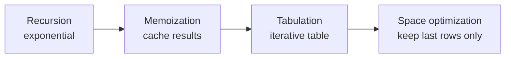

# 15. Dynamic Programming

DP solves problems with **overlapping subproblems** and **optimal substructure** by
storing subproblem answers instead of recomputing them. Do it *after* recursion,
backtracking, and greedy — DP is optimized recursion.

<ProgressTracker id="dsa-dynamic-programming" />

## Table of Contents

- [The DP progression](#the-dp-progression)
- [Pattern 1 — 1D DP](#pattern-1--1d-dp)
- [Pattern 2 — Knapsack](#pattern-2--knapsack)
- [Pattern 3 — Grid DP](#pattern-3--grid-dp)
- [Pattern 4 — String DP](#pattern-4--string-dp)
- [Pattern 5 — LIS](#pattern-5--lis)
- [Pattern 6 — Interval DP](#pattern-6--interval-dp)
- [Pattern 7 — Tree DP](#pattern-7--tree-dp)
- [Problem checklist](#problem-checklist)
- [Things You Should Know](#things-you-should-know)

## The DP progression

<Important>
Every DP problem follows the same evolution. Learn to walk it in interviews:
**Recursion → Memoization (top-down) → Tabulation (bottom-up) → Space optimization.**
Start by writing the brute-force recursion and identifying the state; the rest is
mechanical.
</Important>



Climbing Stairs shown at each stage:

```java
// 1) Recursion — O(2^n)
int rec(int n) { return n <= 2 ? n : rec(n-1) + rec(n-2); }

// 2) Memoization (top-down) — O(n)
int memo(int n, Integer[] dp) {
    if (n <= 2) return n;
    if (dp[n] != null) return dp[n];
    return dp[n] = memo(n-1, dp) + memo(n-2, dp);
}

// 3) Tabulation (bottom-up) — O(n) time, O(n) space
int tab(int n) {
    if (n <= 2) return n;
    int[] dp = new int[n + 1];
    dp[1] = 1; dp[2] = 2;
    for (int i = 3; i <= n; i++) dp[i] = dp[i-1] + dp[i-2];
    return dp[n];
}

// 4) Space optimized — O(n) time, O(1) space
int opt(int n) {
    if (n <= 2) return n;
    int a = 1, b = 2;
    for (int i = 3; i <= n; i++) { int c = a + b; a = b; b = c; }
    return b;
}
```

## Pattern 1 — 1D DP

State depends on a few previous indices.

### House Robber — [LeetCode 198](https://leetcode.com/problems/house-robber/)

```java
// dp[i] = max loot up to house i; rob i (skip i-1) or skip i
int rob(int[] nums) {
    int prev2 = 0, prev1 = 0;
    for (int x : nums) {
        int cur = Math.max(prev1, prev2 + x);   // skip vs rob-this
        prev2 = prev1; prev1 = cur;
    }
    return prev1;
}
```

## Pattern 2 — Knapsack

Choose items under a capacity constraint. **0/1** (each item once) vs **unbounded**
(reusable).

### Coin Change — [LeetCode 322](https://leetcode.com/problems/coin-change/)

```java
// Unbounded knapsack: min coins to make amount; O(amount * coins)
int coinChange(int[] coins, int amount) {
    int[] dp = new int[amount + 1];
    Arrays.fill(dp, amount + 1);        // "infinity"
    dp[0] = 0;
    for (int a = 1; a <= amount; a++)
        for (int c : coins)
            if (c <= a) dp[a] = Math.min(dp[a], dp[a - c] + 1);
    return dp[amount] > amount ? -1 : dp[amount];
}
```

### Partition Equal Subset Sum — [LeetCode 416](https://leetcode.com/problems/partition-equal-subset-sum/)

```java
// 0/1 knapsack: can we hit sum/2? boolean dp over reachable sums
boolean canPartition(int[] nums) {
    int total = Arrays.stream(nums).sum();
    if (total % 2 != 0) return false;
    int target = total / 2;
    boolean[] dp = new boolean[target + 1];
    dp[0] = true;
    for (int x : nums)
        for (int s = target; s >= x; s--)   // iterate DOWN for 0/1 (use each item once)
            dp[s] = dp[s] || dp[s - x];
    return dp[target];
}
```

<Warning>
For **0/1** knapsack with a 1D array, iterate the capacity **downward** so each item is
used at most once. For **unbounded**, iterate **upward** so items can repeat. Mixing
them up is the most common DP bug.
</Warning>

## Pattern 3 — Grid DP

State = a cell `(r, c)`; transitions from top/left.

### Minimum Path Sum — [LeetCode 64](https://leetcode.com/problems/minimum-path-sum/)

```java
// dp[r][c] = min cost to reach (r,c); come from up or left
int minPathSum(int[][] grid) {
    int m = grid.length, n = grid[0].length;
    int[][] dp = new int[m][n];
    for (int r = 0; r < m; r++)
        for (int c = 0; c < n; c++) {
            int fromTop  = r > 0 ? dp[r-1][c] : Integer.MAX_VALUE;
            int fromLeft = c > 0 ? dp[r][c-1] : Integer.MAX_VALUE;
            dp[r][c] = grid[r][c] + (r == 0 && c == 0 ? 0 : Math.min(fromTop, fromLeft));
        }
    return dp[m-1][n-1];
}
```

## Pattern 4 — String DP

Usually a 2D table over two strings (or one string's ranges).

### Longest Common Subsequence — [LeetCode 1143](https://leetcode.com/problems/longest-common-subsequence/)

```java
// dp[i][j] = LCS of a[0..i) and b[0..j); O(m*n)
int longestCommonSubsequence(String a, String b) {
    int m = a.length(), n = b.length();
    int[][] dp = new int[m + 1][n + 1];
    for (int i = 1; i <= m; i++)
        for (int j = 1; j <= n; j++)
            dp[i][j] = (a.charAt(i-1) == b.charAt(j-1))
                ? dp[i-1][j-1] + 1                          // match: extend diagonal
                : Math.max(dp[i-1][j], dp[i][j-1]);          // skip one char
    return dp[m][n];
}
```

*Edit Distance*, *Distinct Subsequences*, and *Longest Palindromic Subsequence* are the
same 2D-table shape with different transitions.

## Pattern 5 — LIS

### Longest Increasing Subsequence — [LeetCode 300](https://leetcode.com/problems/longest-increasing-subsequence/)

```java
// O(n log n): patience sorting — 'tails[k]' = smallest tail of an LIS of length k+1
int lengthOfLIS(int[] nums) {
    List<Integer> tails = new ArrayList<>();
    for (int x : nums) {
        int i = Collections.binarySearch(tails, x);
        if (i < 0) i = -(i + 1);                // insertion point
        if (i == tails.size()) tails.add(x);    // extend
        else tails.set(i, x);                   // replace to keep tails minimal
    }
    return tails.size();
}
```

<Tip>
LIS has an O(n²) DP (`dp[i] = 1 + max(dp[j])` for `j < i, nums[j] < nums[i]`) but the
O(n log n) "patience" version with binary search is the one to know for larger inputs.
</Tip>

## Pattern 6 — Interval DP

State = a range `[i, j]`; combine over a split point `k`.

```java
// Skeleton: solve small ranges first, combine over splits
// dp[i][j] = best for subarray i..j
for (int len = 2; len <= n; len++)
    for (int i = 0; i + len - 1 < n; i++) {
        int j = i + len - 1;
        for (int k = i; k < j; k++)
            dp[i][j] = Math.min(dp[i][j], dp[i][k] + dp[k+1][j] + cost(i, k, j));
    }
```

Examples: *Matrix Chain Multiplication*, *Burst Balloons* (LeetCode 312),
*Palindrome Partitioning II*.

## Pattern 7 — Tree DP

Post-order DP where each node's answer depends on its children (see
[Trees](/docs/dsa/trees/)).

### House Robber III — [LeetCode 337](https://leetcode.com/problems/house-robber-iii/)

```java
// Each node returns {robThis, skipThis}
int rob(TreeNode root) { int[] r = dfs(root); return Math.max(r[0], r[1]); }
int[] dfs(TreeNode n) {
    if (n == null) return new int[]{0, 0};
    int[] l = dfs(n.left), r = dfs(n.right);
    int rob  = n.val + l[1] + r[1];                       // rob n -> skip children
    int skip = Math.max(l[0], l[1]) + Math.max(r[0], r[1]);// free to choose children
    return new int[]{rob, skip};
}
```

## Problem checklist

- 1D: [Climbing Stairs](https://leetcode.com/problems/climbing-stairs/), [House Robber](https://leetcode.com/problems/house-robber/) / [II](https://leetcode.com/problems/house-robber-ii/)
- Knapsack: [Coin Change](https://leetcode.com/problems/coin-change/), [Partition Equal Subset Sum](https://leetcode.com/problems/partition-equal-subset-sum/), [Target Sum](https://leetcode.com/problems/target-sum/)
- Grid: [Unique Paths](https://leetcode.com/problems/unique-paths/), [Minimum Path Sum](https://leetcode.com/problems/minimum-path-sum/)
- String: [LCS](https://leetcode.com/problems/longest-common-subsequence/), [Edit Distance](https://leetcode.com/problems/edit-distance/)
- LIS: [Longest Increasing Subsequence](https://leetcode.com/problems/longest-increasing-subsequence/)
- Interval: [Burst Balloons](https://leetcode.com/problems/burst-balloons/)
- Tree: [House Robber III](https://leetcode.com/problems/house-robber-iii/)

## Things You Should Know

### 🔴 Must Know
- The recursion → memo → tabulation → space-opt progression.
- Identify the **state** and the **transition**.
- 0/1 (iterate down) vs unbounded (iterate up) knapsack.

### 🟡 Good to Know
- 2D string DP (LCS/edit distance) shape.
- LIS in O(n log n); grid DP transitions.

### 🟢 Nice to Know
- Interval DP over split points; tree DP via post-order.
- Bitmask DP for small-N subset states.
