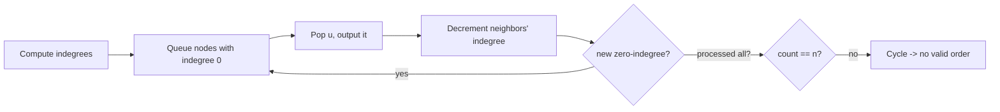

# 11. Graphs

Graphs are one of the biggest interview topics. Most problems reduce to **BFS** or
**DFS** over an adjacency list, plus a few named algorithms.

<ProgressTracker id="dsa-graphs" />

## Table of Contents

- [Representation](#representation)
- [BFS & DFS](#bfs--dfs)
- [Grid graphs: Number of Islands](#grid-graphs-number-of-islands)
- [Connected components](#connected-components)
- [Cycle detection](#cycle-detection)
- [Topological sort](#topological-sort)
- [Problem checklist](#problem-checklist)
- [Things You Should Know](#things-you-should-know)

## Representation

```java
// Adjacency list — the default for sparse graphs
Map<Integer, List<Integer>> graph = new HashMap<>();
graph.computeIfAbsent(u, k -> new ArrayList<>()).add(v);   // edge u -> v
// Undirected: add both directions

// Or an array of lists when nodes are 0..n-1
List<List<Integer>> adj = new ArrayList<>();
for (int i = 0; i < n; i++) adj.add(new ArrayList<>());
```

<Tip>
Use an **adjacency list** (O(V + E) space) for the sparse graphs in interviews. An
adjacency matrix (O(V²)) only makes sense for dense graphs or O(1) edge lookups.
</Tip>

## BFS & DFS

```java
// BFS — shortest path in an UNWEIGHTED graph; explores level by level
void bfs(int start, List<List<Integer>> adj) {
    boolean[] visited = new boolean[adj.size()];
    Queue<Integer> q = new ArrayDeque<>();
    q.offer(start); visited[start] = true;
    while (!q.isEmpty()) {
        int node = q.poll();
        for (int next : adj.get(node)) {
            if (!visited[next]) { visited[next] = true; q.offer(next); }
        }
    }
}

// DFS — recursive; explores as deep as possible first
void dfs(int node, List<List<Integer>> adj, boolean[] visited) {
    visited[node] = true;
    for (int next : adj.get(node))
        if (!visited[next]) dfs(next, adj, visited);
}
```

<Important>
**BFS finds the shortest path in an unweighted graph** (fewest edges), because it
expands in order of distance. DFS does not. For weighted shortest paths use Dijkstra —
see [Graph Algorithms](/docs/dsa/graph-algorithms/).
</Important>

## Grid graphs: Number of Islands

A grid is an implicit graph — each cell connects to its 4 neighbors.

### Number of Islands — [LeetCode 200](https://leetcode.com/problems/number-of-islands/)

```java
// O(m*n): flood-fill each unvisited land cell
int numIslands(char[][] grid) {
    int count = 0;
    for (int r = 0; r < grid.length; r++)
        for (int c = 0; c < grid[0].length; c++)
            if (grid[r][c] == '1') { count++; sink(grid, r, c); }
    return count;
}
void sink(char[][] g, int r, int c) {
    if (r < 0 || c < 0 || r >= g.length || c >= g[0].length || g[r][c] != '1') return;
    g[r][c] = '0';                       // mark visited
    sink(g, r+1, c); sink(g, r-1, c); sink(g, r, c+1); sink(g, r, c-1);
}
```

## Connected components

Count components by launching a traversal from each unvisited node.

### Number of Provinces — [LeetCode 547](https://leetcode.com/problems/number-of-provinces/)

```java
int findCircleNum(int[][] isConnected) {
    int n = isConnected.length, count = 0;
    boolean[] seen = new boolean[n];
    for (int i = 0; i < n; i++) {
        if (!seen[i]) { count++; dfsProvince(isConnected, i, seen); }
    }
    return count;
}
void dfsProvince(int[][] m, int i, boolean[] seen) {
    seen[i] = true;
    for (int j = 0; j < m.length; j++)
        if (m[i][j] == 1 && !seen[j]) dfsProvince(m, j, seen);
}
```

<Tip>
Connected-components and "dynamic connectivity" problems are also a perfect fit for
**Union-Find (DSU)** — see [Graph Algorithms](/docs/dsa/graph-algorithms/#disjoint-set-union-union-find).
</Tip>

## Cycle detection

- **Undirected:** during DFS, a visited neighbor that isn't the parent means a cycle.
- **Directed:** a node currently **on the recursion stack** (gray) that you revisit
  means a back edge → cycle.

```java
// Directed cycle detection with 3-color DFS
boolean hasCycle(int n, List<List<Integer>> adj) {
    int[] state = new int[n];   // 0=unvisited, 1=in-progress, 2=done
    for (int i = 0; i < n; i++) if (state[i] == 0 && dfsCycle(i, adj, state)) return true;
    return false;
}
boolean dfsCycle(int u, List<List<Integer>> adj, int[] state) {
    state[u] = 1;                               // mark in-progress
    for (int v : adj.get(u)) {
        if (state[v] == 1) return true;         // back edge -> cycle
        if (state[v] == 0 && dfsCycle(v, adj, state)) return true;
    }
    state[u] = 2;                               // done
    return false;
}
```

## Topological sort

A linear ordering of a **DAG** (directed acyclic graph) where every edge `u → v` puts
`u` before `v`. Used for build/dependency ordering and course scheduling.

### Kahn's algorithm (BFS, indegrees)

```java
// Course Schedule II — LeetCode 210: return a valid order, or empty if a cycle exists
int[] findOrder(int numCourses, int[][] prereqs) {
    List<List<Integer>> adj = new ArrayList<>();
    for (int i = 0; i < numCourses; i++) adj.add(new ArrayList<>());
    int[] indeg = new int[numCourses];
    for (int[] p : prereqs) { adj.get(p[1]).add(p[0]); indeg[p[0]]++; }

    Queue<Integer> q = new ArrayDeque<>();
    for (int i = 0; i < numCourses; i++) if (indeg[i] == 0) q.offer(i);

    int[] order = new int[numCourses]; int idx = 0;
    while (!q.isEmpty()) {
        int u = q.poll(); order[idx++] = u;
        for (int v : adj.get(u)) if (--indeg[v] == 0) q.offer(v);
    }
    return idx == numCourses ? order : new int[0];   // incomplete -> cycle
}
```



<Important>
Kahn's doubles as **cycle detection for a DAG**: if you can't output all N nodes (some
never reach indegree 0), the graph has a cycle. That's exactly how *Course Schedule*
detects impossible prerequisites.
</Important>

## Problem checklist

- [Number of Islands](https://leetcode.com/problems/number-of-islands/) · flood fill
- [Clone Graph](https://leetcode.com/problems/clone-graph/) · BFS/DFS + map
- [Number of Provinces](https://leetcode.com/problems/number-of-provinces/) · components
- [Rotting Oranges](https://leetcode.com/problems/rotting-oranges/) · multi-source BFS
- [Course Schedule](https://leetcode.com/problems/course-schedule/) / [II](https://leetcode.com/problems/course-schedule-ii/) · topo sort
- [Pacific Atlantic Water Flow](https://leetcode.com/problems/pacific-atlantic-water-flow/) · DFS from borders
- [Graph Valid Tree](https://leetcode.com/problems/graph-valid-tree/) · DSU / DFS
- [Word Ladder](https://leetcode.com/problems/word-ladder/) · BFS shortest path

## Things You Should Know

### 🔴 Must Know
- Adjacency-list representation; BFS vs DFS.
- BFS = shortest path in unweighted graphs.
- Topological sort via Kahn's; it detects DAG cycles.

### 🟡 Good to Know
- Grid-as-graph flood fill; multi-source BFS (Rotting Oranges).
- Directed cycle detection with 3-color DFS.

### 🟢 Nice to Know
- 0-1 BFS with a deque; bidirectional BFS.
