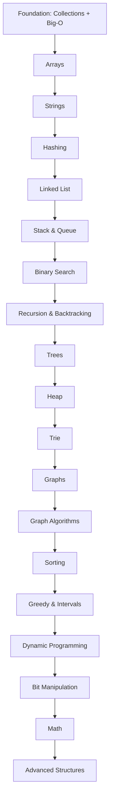

# DSA with Java

Data structures and algorithms are how you pass the coding round. This track is
**pattern-first**: learn the handful of patterns that unlock most problems, code each
one in idiomatic Java, and always compare the **brute-force** and **optimal**
approaches so you know *why* the optimal works.

<ProgressTracker id="dsa-overview" />

## Table of Contents

- [How to use this track](#how-to-use-this-track)
- [The problem sets](#the-problem-sets)
- [Complexity primer](#complexity-primer)
- [The roadmap](#the-roadmap)
- [Topics](#topics)
- [Things You Should Know](#things-you-should-know)

## How to use this track

1. Start with the [Java DSA Foundation](/docs/dsa/foundation/) — the collections and
   language features every solution uses.
2. Go **topic by topic** in order. Arrays → Strings → Hashing first; they underpin
   everything.
3. For each problem, write the **brute force** first (get *a* solution), then optimize
   with the pattern. Interviewers want to see that progression.
4. Track complexity for every solution — time **and** space.

<Important>
Do not memorize solutions. Memorize **patterns**: two pointers, sliding window, prefix
sum, binary search on the answer, backtracking, BFS/DFS, and the DP transitions.
Roughly 15 patterns cover the vast majority of interview questions.
</Important>

## The problem sets

Practice against the two industry-standard curated lists — they're ordered, deduped,
and cover every pattern here:

- **[Blind 75](https://neetcode.io/practice?tab=blind75)** — the classic 75-problem
  list. Do this first; it's the minimum bar.
- **[NeetCode 150](https://neetcode.io/practice?tab=neetcode150)** — Blind 75 plus 75
  more for fuller pattern coverage.
- Problem links throughout this track point to **[LeetCode](https://leetcode.com/)**.

<Tip>
Aim for Blind 75 fully solved before interviews, then extend to NeetCode 150. Quality
over quantity — 150 problems you can re-derive beats 500 you memorized.
</Tip>

## Complexity primer

Every solution is judged on **time** and **space** complexity (Big-O = worst-case
growth as input `n` grows).

| Big-O | Name | Example |
| --- | --- | --- |
| O(1) | Constant | HashMap get, array index |
| O(log n) | Logarithmic | Binary search |
| O(n) | Linear | Single loop |
| O(n log n) | Linearithmic | Efficient sorts, heap of n items |
| O(n²) | Quadratic | Nested loops (brute-force pair scan) |
| O(2ⁿ) | Exponential | Subsets, naive recursion |
| O(n!) | Factorial | Permutations |

<Important>
The most common interview win is turning an **O(n²)** brute force into **O(n)** or
**O(n log n)** using a hash map, two pointers, sliding window, sorting, or binary
search. Recognizing that jump is the whole game.
</Important>

## The roadmap

## Topics

  <Link className="jbm-card" to="/docs/dsa/foundation">
🧰
<h3>0. Foundation</h3>
Collections, equals/hashCode, comparators, Big-O.
</Link>
  <Link className="jbm-card" to="/docs/dsa/arrays">
🔢
<h3>1. Arrays</h3>
Two pointers, sliding window, prefix sum, Kadane, binary search.
</Link>
  <Link className="jbm-card" to="/docs/dsa/strings">
🔤
<h3>2. Strings</h3>
Palindrome, anagram, substring windows.
</Link>
  <Link className="jbm-card" to="/docs/dsa/hashing">
🗂️
<h3>3. Hashing</h3>
Frequency, complement, prefix-sum + map, grouping.
</Link>
  <Link className="jbm-card" to="/docs/dsa/linked-list">
🔗
<h3>4. Linked List</h3>
Fast/slow, reversal, dummy node, merge.
</Link>
  <Link className="jbm-card" to="/docs/dsa/stack-queue">
🥞
<h3>5. Stack & Queue</h3>
Monotonic stack/queue, expression parsing.
</Link>
  <Link className="jbm-card" to="/docs/dsa/binary-search">
🎯
<h3>6. Binary Search</h3>
Boundaries, rotated arrays, search on the answer.
</Link>
  <Link className="jbm-card" to="/docs/dsa/recursion-backtracking">
🌀
<h3>7. Recursion & Backtracking</h3>
Subsets, permutations, combinations, N-Queens.
</Link>
  <Link className="jbm-card" to="/docs/dsa/trees">
🌳
<h3>8. Trees</h3>
DFS/BFS traversals, BST, LCA, path sums.
</Link>
  <Link className="jbm-card" to="/docs/dsa/heap">
⛰️
<h3>9. Heap / Priority Queue</h3>
Top-K, two heaps, merge-K, scheduling.
</Link>
  <Link className="jbm-card" to="/docs/dsa/trie">
🌲
<h3>10. Trie</h3>
Insert/search/startsWith, word search, autocomplete.
</Link>
  <Link className="jbm-card" to="/docs/dsa/graphs">
🕸️
<h3>11. Graphs</h3>
BFS/DFS, components, cycles, topological sort.
</Link>
  <Link className="jbm-card" to="/docs/dsa/graph-algorithms">
🛰️
<h3>12. Graph Algorithms</h3>
Dijkstra, Bellman-Ford, Floyd-Warshall, MST, DSU.
</Link>
  <Link className="jbm-card" to="/docs/dsa/sorting">
📊
<h3>13. Sorting</h3>
Merge, quick, heap, counting; Java comparators.
</Link>
  <Link className="jbm-card" to="/docs/dsa/greedy-intervals">
💰
<h3>14. Greedy & Intervals</h3>
Interval scheduling, merge intervals, jump game.
</Link>
  <Link className="jbm-card" to="/docs/dsa/dynamic-programming">
🧠
<h3>15. Dynamic Programming</h3>
1D, knapsack, grid, string, LIS, interval, tree DP.
</Link>
  <Link className="jbm-card" to="/docs/dsa/bit-manipulation">
🔟
<h3>16. Bit Manipulation</h3>
XOR tricks, masks, power of two.
</Link>
  <Link className="jbm-card" to="/docs/dsa/math">
➗
<h3>17. Math & Number Theory</h3>
GCD, sieve, fast exponentiation, modular arithmetic.
</Link>
  <Link className="jbm-card" to="/docs/dsa/advanced-data-structures">
🏛️
<h3>18. Advanced Structures</h3>
Segment tree, Fenwick/BIT, sparse table, bitwise trie.
</Link>

## Things You Should Know

### 🔴 Must Know
- Big-O for time and space; the O(n²) → O(n)/O(n log n) jump.
- The core patterns: two pointers, sliding window, prefix sum, binary search, BFS/DFS, backtracking, DP.
- Java collections and when to use each ([Foundation](/docs/dsa/foundation/)).

### 🟡 Good to Know
- Brute-force first, then optimize — and articulate the trade-off.
- Blind 75 → NeetCode 150 progression.

### 🟢 Nice to Know
- Advanced structures (segment tree, BIT) for competitive/rare interview needs.
