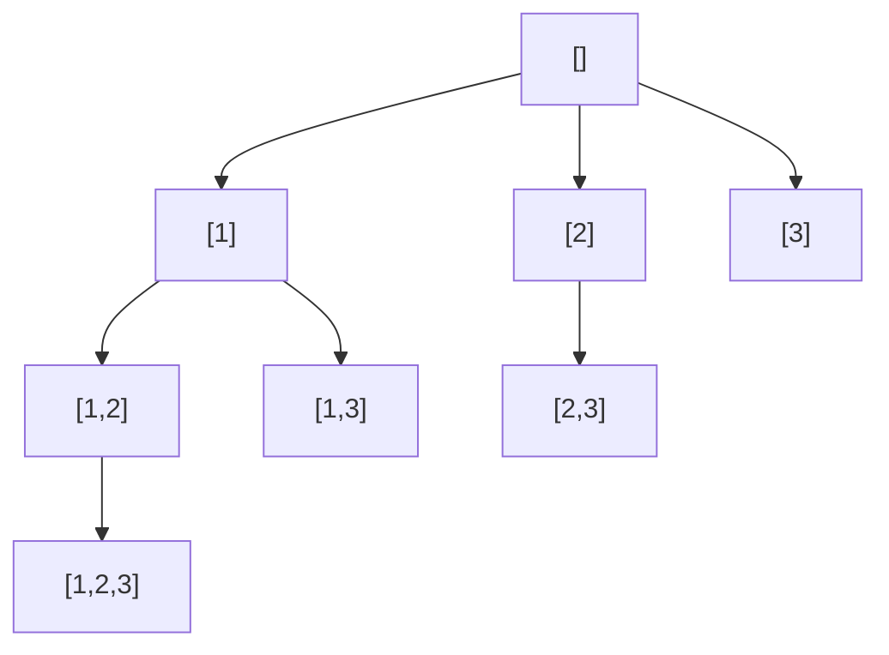

# 7. Recursion & Backtracking

Recursion solves a problem in terms of smaller subproblems. **Backtracking** is
recursion that explores all candidates, undoing each choice before trying the next — the
key to subsets, permutations, and constraint problems.

<ProgressTracker id="dsa-recursion-backtracking" />

## Table of Contents

- [Recursion basics](#recursion-basics)
- [The backtracking template](#the-backtracking-template)
- [Subsets](#subsets)
- [Permutations](#permutations)
- [Combination Sum](#combination-sum)
- [Grid backtracking: Word Search](#grid-backtracking-word-search)
- [N-Queens](#n-queens)
- [Problem checklist](#problem-checklist)
- [Things You Should Know](#things-you-should-know)

## Recursion basics

Every recursion needs a **base case** (stop) and a **recursive case** (shrink toward
the base). Each call adds a frame to the call stack.

```java
int factorial(int n) {
    if (n <= 1) return 1;          // base case
    return n * factorial(n - 1);   // recursive case
}

double power(double x, int n) {    // fast exponentiation — O(log n)
    if (n == 0) return 1;
    double half = power(x, n / 2);
    return (n % 2 == 0) ? half * half : half * half * x;
}
```

<Warning>
Missing or unreachable base cases cause `StackOverflowError`. Deep recursion (n in the
tens of thousands) can overflow the stack even when correct — consider an iterative
version or increase `-Xss`.
</Warning>

## The backtracking template

<Important>
Every backtracking solution is the same skeleton: **choose → explore → undo**. Add to
the current path, recurse, then remove what you added. Prune branches that can't lead to
a valid answer.
</Important>

```java
void backtrack(State path, Choices choices) {
    if (isComplete(path)) {
        result.add(copyOf(path));    // record a solution (copy!)
        return;
    }
    for (Choice c : choices) {
        if (!valid(c)) continue;     // prune
        path.add(c);                 // choose
        backtrack(path, next(choices, c));   // explore
        path.removeLast();           // undo
    }
}
```

## Subsets

### Subsets — [LeetCode 78](https://leetcode.com/problems/subsets/)

```java
// O(2^n * n): for each element, choose to include it or not
List<List<Integer>> subsets(int[] nums) {
    List<List<Integer>> res = new ArrayList<>();
    backtrack(nums, 0, new ArrayList<>(), res);
    return res;
}
void backtrack(int[] nums, int start, List<Integer> path, List<List<Integer>> res) {
    res.add(new ArrayList<>(path));           // every node is a valid subset
    for (int i = start; i < nums.length; i++) {
        path.add(nums[i]);                    // choose
        backtrack(nums, i + 1, path, res);    // explore (i+1 avoids reuse)
        path.remove(path.size() - 1);         // undo
    }
}
```



## Permutations

### Permutations — [LeetCode 46](https://leetcode.com/problems/permutations/)

```java
// O(n! * n): try each unused element at each position
List<List<Integer>> permute(int[] nums) {
    List<List<Integer>> res = new ArrayList<>();
    backtrack(nums, new boolean[nums.length], new ArrayList<>(), res);
    return res;
}
void backtrack(int[] nums, boolean[] used, List<Integer> path, List<List<Integer>> res) {
    if (path.size() == nums.length) { res.add(new ArrayList<>(path)); return; }
    for (int i = 0; i < nums.length; i++) {
        if (used[i]) continue;               // skip already-placed
        used[i] = true; path.add(nums[i]);   // choose
        backtrack(nums, used, path, res);    // explore
        used[i] = false; path.remove(path.size() - 1);  // undo
    }
}
```

## Combination Sum

### Combination Sum — [LeetCode 39](https://leetcode.com/problems/combination-sum/)

```java
// Numbers reusable; prune when remaining goes negative
List<List<Integer>> combinationSum(int[] candidates, int target) {
    List<List<Integer>> res = new ArrayList<>();
    backtrack(candidates, 0, target, new ArrayList<>(), res);
    return res;
}
void backtrack(int[] c, int start, int remain, List<Integer> path, List<List<Integer>> res) {
    if (remain == 0) { res.add(new ArrayList<>(path)); return; }
    if (remain < 0) return;                   // prune
    for (int i = start; i < c.length; i++) {
        path.add(c[i]);
        backtrack(c, i, remain - c[i], path, res);  // i (not i+1): reuse allowed
        path.remove(path.size() - 1);
    }
}
```

## Grid backtracking: Word Search

### Word Search — [LeetCode 79](https://leetcode.com/problems/word-search/)

```java
// DFS from each cell, mark visited, backtrack
boolean exist(char[][] board, String word) {
    for (int r = 0; r < board.length; r++)
        for (int col = 0; col < board[0].length; col++)
            if (dfs(board, word, 0, r, col)) return true;
    return false;
}
boolean dfs(char[][] b, String w, int k, int r, int c) {
    if (k == w.length()) return true;
    if (r < 0 || c < 0 || r >= b.length || c >= b[0].length || b[r][c] != w.charAt(k))
        return false;
    char tmp = b[r][c];
    b[r][c] = '#';                            // mark visited
    boolean found = dfs(b, w, k+1, r+1, c) || dfs(b, w, k+1, r-1, c)
                 || dfs(b, w, k+1, r, c+1) || dfs(b, w, k+1, r, c-1);
    b[r][c] = tmp;                            // undo
    return found;
}
```

## N-Queens

### N-Queens — [LeetCode 51](https://leetcode.com/problems/n-queens/)

```java
// Place one queen per row; track attacked columns and diagonals
List<List<String>> solveNQueens(int n) {
    List<List<String>> res = new ArrayList<>();
    place(0, n, new int[n], new boolean[n], new boolean[2*n], new boolean[2*n], res);
    return res;
}
void place(int row, int n, int[] cols, boolean[] col, boolean[] diag, boolean[] anti,
           List<List<String>> res) {
    if (row == n) { res.add(build(cols, n)); return; }
    for (int c = 0; c < n; c++) {
        int d = row - c + n, a = row + c;     // diagonal ids
        if (col[c] || diag[d] || anti[a]) continue;   // attacked -> prune
        cols[row] = c; col[c] = diag[d] = anti[a] = true;      // choose
        place(row + 1, n, cols, col, diag, anti, res);          // explore
        col[c] = diag[d] = anti[a] = false;   // undo
    }
}
```

<Tip>
The N-Queens speed-up: track attacked **columns** and both **diagonals** with boolean
arrays so each placement check is O(1). Diagonal ids: `row - col + n` and `row + col`.
</Tip>

## Problem checklist

- [Subsets](https://leetcode.com/problems/subsets/) / [Subsets II](https://leetcode.com/problems/subsets-ii/)
- [Permutations](https://leetcode.com/problems/permutations/)
- [Combination Sum](https://leetcode.com/problems/combination-sum/) / [II](https://leetcode.com/problems/combination-sum-ii/)
- [Letter Combinations of a Phone Number](https://leetcode.com/problems/letter-combinations-of-a-phone-number/)
- [Generate Parentheses](https://leetcode.com/problems/generate-parentheses/)
- [Word Search](https://leetcode.com/problems/word-search/)
- [Palindrome Partitioning](https://leetcode.com/problems/palindrome-partitioning/)
- [N-Queens](https://leetcode.com/problems/n-queens/)
- [Sudoku Solver](https://leetcode.com/problems/sudoku-solver/)

## Things You Should Know

### 🔴 Must Know
- Base case + recursive case; the choose/explore/undo template.
- Copy the path when recording (`new ArrayList<>(path)`).
- `start` index (subsets/combos) vs `used[]` (permutations).

### 🟡 Good to Know
- Pruning (remaining &lt; 0, sorted-skip for duplicates).
- Grid DFS with visited-marking + undo.

### 🟢 Nice to Know
- Fast exponentiation via recursion.
- Iterative subsets via bitmasks ([Bit Manipulation](/docs/dsa/bit-manipulation/)).
