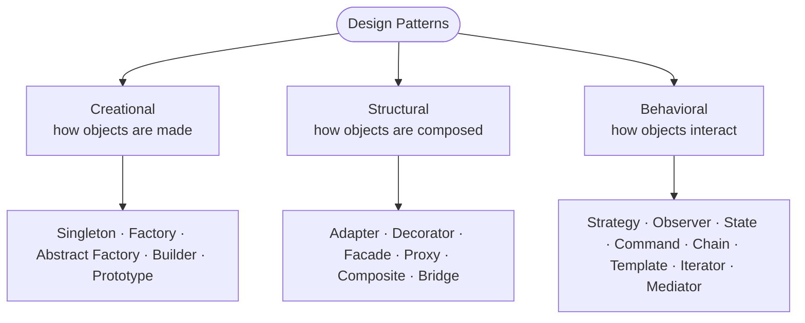
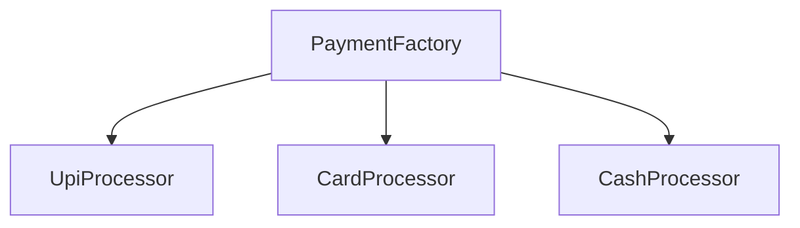
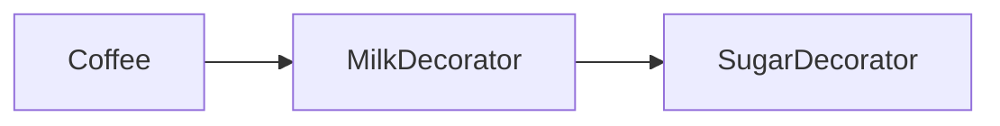
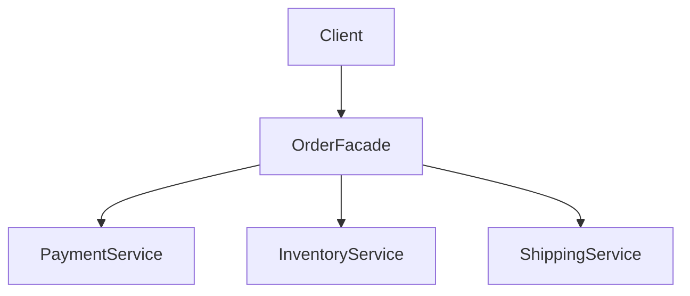
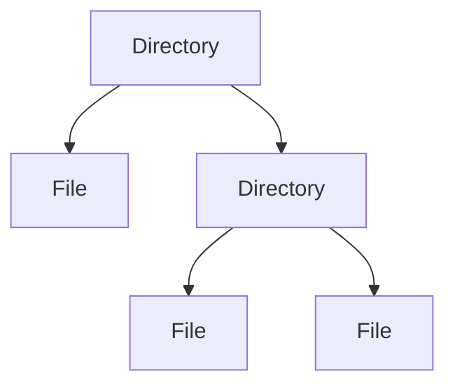
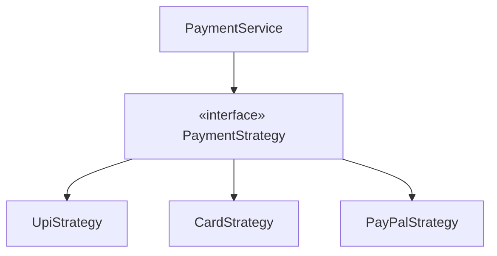
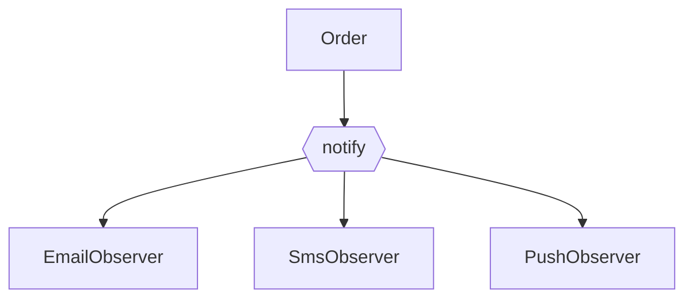
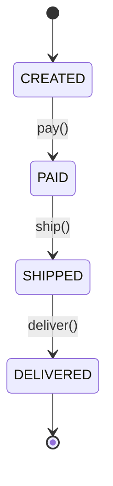
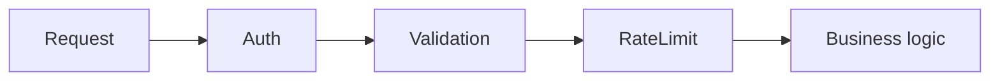

# Design Patterns for LLD

Don't memorize patterns blindly. Learn each as **Problem → Pattern → Trade-off** — what
pain it removes and what it costs. That framing is what lets you *choose* a pattern in
an interview instead of name-dropping one. This is the LLD companion to
[Backend Patterns](/docs/patterns/).

<ProgressTracker id="lld-patterns" />

## Table of Contents

- [How to think about patterns](#how-to-think-about-patterns)
- [Creational patterns](#creational-patterns)
  - [Singleton](#singleton)
  - [Factory](#factory)
  - [Abstract Factory](#abstract-factory)
  - [Builder](#builder)
  - [Prototype](#prototype)
- [Structural patterns](#structural-patterns)
  - [Adapter](#adapter)
  - [Decorator](#decorator)
  - [Facade](#facade)
  - [Proxy](#proxy)
  - [Composite](#composite)
  - [Bridge](#bridge)
- [Behavioral patterns](#behavioral-patterns)
  - [Strategy](#strategy)
  - [Observer](#observer)
  - [State](#state)
  - [Command](#command)
  - [Chain of Responsibility](#chain-of-responsibility)
  - [Template Method](#template-method)
  - [Iterator & Mediator](#iterator--mediator)
- [Most Asked Interview Questions](#most-asked-interview-questions)
- [Things You Should Know](#things-you-should-know)

## How to think about patterns

Patterns fall into three families by *what they organize*:



<Important>
For each pattern below, be able to state three things in one breath: **the problem it
solves**, **a real backend use case**, and **its main trade-off**. That's the exact
shape of the follow-up question.
</Important>

## Creational patterns

### Singleton

**Problem:** exactly one instance must exist (a registry, a config, a connection pool).

```java
// Preferred: enum singleton — thread-safe, serialization-safe, no reflection attack
enum IdGenerator {
    INSTANCE;
    private final AtomicLong counter = new AtomicLong();
    public long next() { return counter.incrementAndGet(); }
}

// If you need lazy init with a class, use the holder idiom (JVM guarantees safety)
class Config {
    private Config() { }
    private static class Holder { static final Config INSTANCE = new Config(); }
    static Config get() { return Holder.INSTANCE; }
}
```

The `synchronized`/double-checked-locking route is the classic interview trap:

```java
class Config {
    private static volatile Config instance;          // volatile is essential
    static Config get() {
        if (instance == null) {                       // 1st check (no lock)
            synchronized (Config.class) {
                if (instance == null) instance = new Config();  // 2nd check
            }
        }
        return instance;
    }
}
```

<Warning>
Singletons introduce **global mutable state**: they hurt testability (hard to mock),
hide dependencies, and can become concurrency bottlenecks. In Spring you rarely
hand-roll one — a `@Service` bean is a container-managed singleton done safely. Prefer
that. **Trade-off:** convenience now, coupling and test pain later.
</Warning>

### Factory

**Problem:** object-creation logic should be separated from the code that uses the
object, and the concrete type chosen at runtime.



```java
interface PaymentProcessor { void pay(Money amount); }

class PaymentFactory {
    PaymentProcessor create(PaymentMethod method) {
        return switch (method) {
            case UPI  -> new UpiProcessor();
            case CARD -> new CardProcessor();
            case CASH -> new CashProcessor();
        };
    }
}
```

**Trade-off:** centralizes creation (good), but the factory itself is the one place
that knows every type — pair it with **Strategy** so callers stay decoupled.

### Abstract Factory

**Problem:** create **families of related objects** without binding to concretions —
e.g. a UI toolkit that must produce a matching `Button` *and* `Checkbox` per theme.

```java
interface UiFactory { Button button(); Checkbox checkbox(); }
class DarkFactory  implements UiFactory { public Button button(){return new DarkButton();}  public Checkbox checkbox(){return new DarkCheckbox();} }
class LightFactory implements UiFactory { public Button button(){return new LightButton();} public Checkbox checkbox(){return new LightCheckbox();} }
```

**Trade-off:** guarantees compatible families, but adding a new *product* means editing
every factory.

### Builder

**Problem:** construct a complex or immutable object with many optional fields, without
a telescoping constructor.

```java
User user = User.builder()
    .name("Pawan")
    .email("pawan@example.com")
    .age(25)
    .build();                       // readable, immutable result
```

```java
public final class User {
    private final String name, email; private final int age;
    private User(Builder b) { this.name = b.name; this.email = b.email; this.age = b.age; }
    static Builder builder() { return new Builder(); }

    static class Builder {
        private String name, email; private int age;
        Builder name(String n)  { this.name = n; return this; }
        Builder email(String e) { this.email = e; return this; }
        Builder age(int a)      { this.age = a; return this; }
        User build() {
            if (name == null) throw new IllegalStateException("name required");
            return new User(this);
        }
    }
}
```

**Trade-off:** verbose to hand-write (use Lombok's `@Builder` or a record for simple
cases); worth it for objects with many optional fields or validation.

### Prototype

**Problem:** creating an object is expensive, so **clone an existing instance** instead
of building from scratch.

```java
interface Prototype<T> { T copy(); }
record Document(String title, List<String> pages) implements Prototype<Document> {
    public Document copy() { return new Document(title, List.copyOf(pages)); }  // deep-ish copy
}
```

**Trade-off:** less common; deep vs shallow copy is a subtle bug source. Know the
concept and that Java's `Cloneable`/`clone()` is generally discouraged.

## Structural patterns

### Adapter

**Problem:** make an incompatible interface fit the one your code expects — classically,
wrapping a third-party SDK.


```java
interface PaymentGateway { void charge(Money amount); }         // our contract

class StripeAdapter implements PaymentGateway {                  // adapter
    private final com.stripe.StripeClient stripe;
    public void charge(Money amount) {
        stripe.charges().create(amount.toCents(), amount.currencyCode()); // translate
    }
}
```

**Trade-off:** an extra layer, but it isolates third-party churn behind your interface.

### Decorator

**Problem:** add behavior to an object **without modifying its class** or exploding into
subclasses. Each decorator wraps and forwards.



```java
interface Coffee { BigDecimal cost(); }
record Espresso() implements Coffee { public BigDecimal cost() { return new BigDecimal("2.00"); } }

abstract class CoffeeDecorator implements Coffee {
    protected final Coffee inner;
    protected CoffeeDecorator(Coffee inner) { this.inner = inner; }
}
class Milk extends CoffeeDecorator {
    Milk(Coffee c) { super(c); }
    public BigDecimal cost() { return inner.cost().add(new BigDecimal("0.50")); }
}

Coffee order = new Milk(new Espresso());   // 2.50, stackable
```

**Trade-off:** flexible composition at runtime, but many small classes and deep wrapping
can be hard to debug. This is exactly how `java.io` streams (`BufferedInputStream(...)`)
work.

### Facade

**Problem:** a subsystem is complex; give clients **one simplified entry point**.



```java
class OrderFacade {
    private final PaymentService payment; private final InventoryService inventory;
    private final ShippingService shipping;
    // constructor injection ...
    void placeOrder(Order o) {
        inventory.reserve(o); payment.charge(o.total()); shipping.schedule(o);
    }
}
```

**Trade-off:** simplifies the client, but the facade can grow into a god object if it
starts holding business logic instead of just orchestrating.

### Proxy

**Problem:** control access to an object — add lazy loading, authorization, logging,
caching, or remote access **transparently**.

```java
interface Image { void render(); }
class RealImage implements Image {
    RealImage(String path) { loadFromDisk(path); }   // expensive
    public void render() { ... }
}
class LazyImage implements Image {                    // virtual proxy
    private final String path; private RealImage real;
    LazyImage(String path) { this.path = path; }
    public void render() {
        if (real == null) real = new RealImage(path); // load on first use
        real.render();
    }
}
```

**Trade-off:** an indirection layer. This is precisely how Spring implements
`@Transactional` and `@Cacheable` — a proxy wraps your bean (see [AOP](/docs/spring-core/)).

### Composite

**Problem:** treat individual objects and groups of objects **uniformly** — tree
structures like a file system, UI components, or an org hierarchy.



```java
interface Node { long size(); }
record File(String name, long size) implements Node {
    public long size() { return size; }
}
class Directory implements Node {
    private final List<Node> children = new ArrayList<>();
    void add(Node n) { children.add(n); }
    public long size() { return children.stream().mapToLong(Node::size).sum(); } // recurse
}
```

**Trade-off:** uniform recursion is elegant, but the shared interface can become too
generic (leaf nodes forced to implement `add`/`remove`).

### Bridge

**Problem:** separate an **abstraction** from its **implementation** so the two vary
independently — avoids a class explosion like `RedCircle`, `BlueCircle`, `RedSquare`…

```java
interface Renderer { void drawCircle(double r); }          // implementation axis
abstract class Shape {                                      // abstraction axis
    protected final Renderer renderer;
    protected Shape(Renderer r) { this.renderer = r; }
    abstract void draw();
}
class Circle extends Shape {
    private final double r;
    Circle(Renderer rn, double r) { super(rn); this.r = r; }
    void draw() { renderer.drawCircle(r); }
}
// new shapes × new renderers combine freely instead of multiplying subclasses
```

**Trade-off:** more upfront structure; pays off only when both dimensions really vary.

## Behavioral patterns

### Strategy

**MUST KNOW** — probably the most useful pattern in real backend code.

**Problem:** a behavior has interchangeable variants that should be selectable at
runtime (payment methods, pricing rules, sorting orders, shipping cost).



```java
interface PaymentStrategy { void pay(Money amount); }

class PaymentService {
    private final PaymentStrategy strategy;                 // injected
    PaymentService(PaymentStrategy strategy) { this.strategy = strategy; }
    void checkout(Money amount) { strategy.pay(amount); }
}
```

**Trade-off:** many small classes, but adding a variant needs **no change** to
`PaymentService` — Strategy + Factory + OCP working together. In Spring, inject a
`Map<String, PaymentStrategy>` and pick by key.

### Observer

**Problem:** when one object changes, an open-ended set of others must react — **event
notification** without tight coupling.



```java
interface OrderObserver { void onPlaced(Order o); }

class Order {
    private final List<OrderObserver> observers = new ArrayList<>();
    void subscribe(OrderObserver o) { observers.add(o); }
    void place() { observers.forEach(o -> o.onPlaced(this)); }   // fan-out
}
```

**Trade-off:** decoupled and extensible, but notification order and error handling need
care. Spring's `ApplicationEventPublisher` and Kafka are Observer at different scales.

### State

**Problem:** an object's behavior depends on its **lifecycle state**, and transitions
have rules. Replaces sprawling `if (status == ...)` checks.



```java
interface OrderState { OrderState pay(); OrderState ship(); }

class Created implements OrderState {
    public OrderState pay()  { return new Paid(); }
    public OrderState ship() { throw new IllegalStateException("pay first"); }
}
class Paid implements OrderState {
    public OrderState pay()  { throw new IllegalStateException("already paid"); }
    public OrderState ship() { return new Shipped(); }
}
```

**Trade-off:** each state is a class (more files), but illegal transitions become
impossible by construction. Common in vending machines, ATMs, and order lifecycles.

### Command

**Problem:** encapsulate a request as an object so you can **queue, log, schedule, or
undo** it.

```java
interface Command { void execute(); void undo(); }

class AddItemCommand implements Command {
    private final Cart cart; private final Item item;
    AddItemCommand(Cart cart, Item item) { this.cart = cart; this.item = item; }
    public void execute() { cart.add(item); }
    public void undo()    { cart.remove(item); }
}
// commands can be pushed to a queue, retried, or reversed for undo/redo
```

**Trade-off:** decouples invoker from receiver and enables undo/queues, at the cost of
a class per action. Backs task processing, job queues, and editor undo stacks.

### Chain of Responsibility

**Problem:** a request should pass through a **pipeline of handlers**, each able to
handle or pass it on.



```java
abstract class Handler {
    protected Handler next;
    Handler setNext(Handler next) { this.next = next; return next; }
    abstract void handle(Request r);
    protected void forward(Request r) { if (next != null) next.handle(r); }
}
class AuthHandler extends Handler {
    void handle(Request r) {
        if (!r.isAuthenticated()) throw new SecurityException();
        forward(r);
    }
}
```

**Trade-off:** flexible, reorderable pipeline, but a request can fall off the end
unhandled. The **Spring Security filter chain** and servlet filters are textbook
examples.

### Template Method

**Problem:** several algorithms share the **same skeleton** but differ in a few steps.
The base class fixes the order; subclasses fill the steps.

```java
abstract class DataImporter {
    public final void run() {          // template: fixed skeleton, final
        var raw = read();
        var clean = validate(raw);
        save(clean);
    }
    protected abstract List<Row> read();
    protected abstract List<Row> validate(List<Row> raw);
    protected abstract void save(List<Row> rows);
}
```

**Trade-off:** reuses the skeleton via inheritance (which couples subclasses to the
base). Strategy is the composition-based alternative when you need runtime swapping.

### Iterator & Mediator

**Iterator** — traverse a collection without exposing its internal structure. Java's
`Iterator`/`Iterable` and the enhanced `for` loop are built-in implementations.

**Mediator** — centralize communication between many objects so they don't reference
each other directly (e.g. a chat room routing messages, or air-traffic control). Cuts
an N×N web of references down to N. **Trade-off:** the mediator can become a god object.

## Most Asked Interview Questions

### Beginner
- What are the three categories of design patterns?
- What problem does the Factory pattern solve?

### Intermediate
- Strategy vs State — they look similar; how do they differ?
- Why is a Spring `@Service` a better singleton than a hand-written one?
- How does the Decorator pattern differ from inheritance?

### Advanced
- Where does Spring use the Proxy pattern, and how?
- Design a payment flow using Strategy + Factory so new providers need no edits.
- Model an order lifecycle with the State pattern.

### Coding
- Implement a thread-safe Singleton (enum or holder idiom).
- Build a Chain of Responsibility for auth → validation → rate limit.

## Things You Should Know

### 🔴 Must Know
- Factory, Builder, Strategy, Observer, Decorator, State.
- Singleton pitfalls and the safe (enum/holder) forms.
- Problem → Pattern → Trade-off for each.

### 🟡 Good to Know
- Adapter, Facade, Proxy, Composite, Command, Chain of Responsibility.
- How Spring uses Proxy (AOP) and Singleton (beans).

### 🟢 Nice to Know
- Abstract Factory, Prototype, Bridge, Template Method, Iterator, Mediator.
- Strategy vs Template Method (composition vs inheritance).
