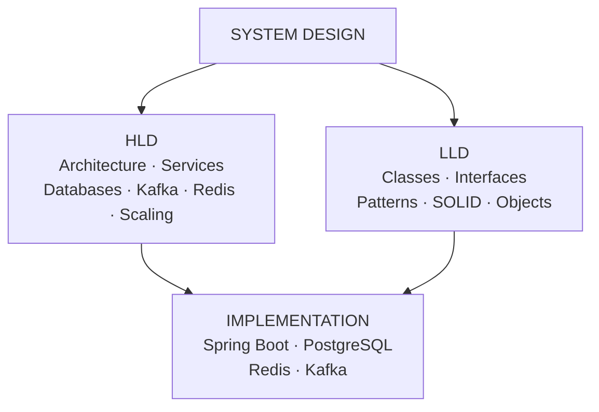
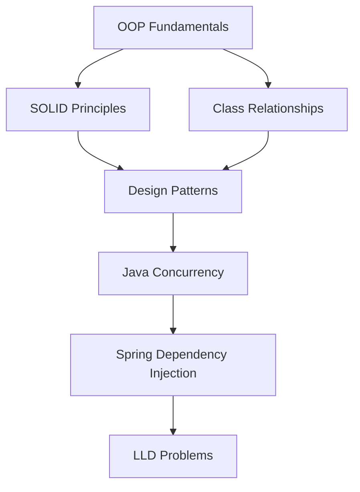
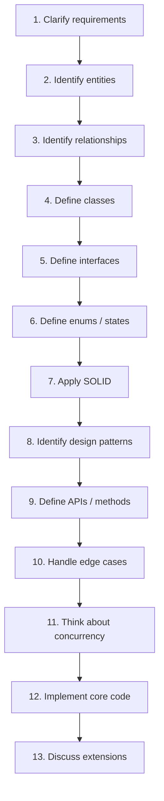
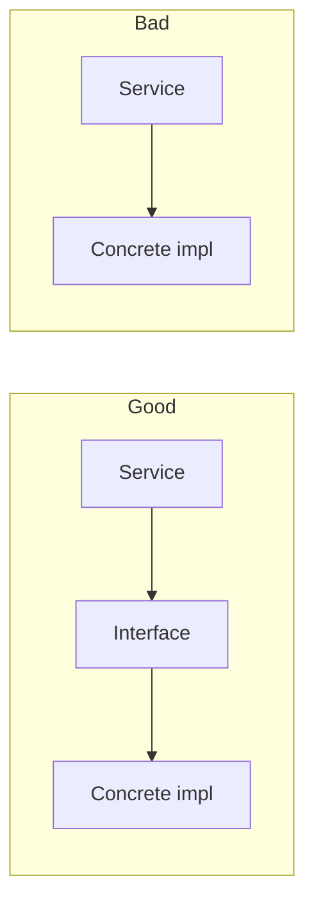
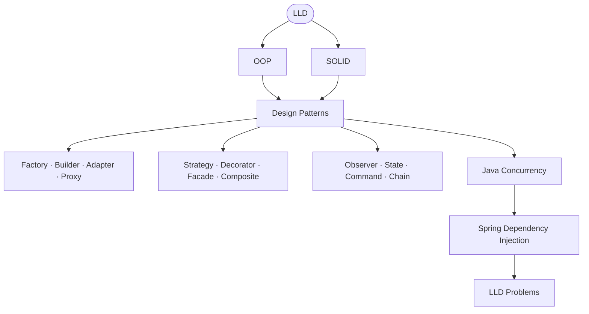

# Low-Level Design (LLD)

For Java backend interviews, **LLD is where you prove you can turn requirements into
clean, extensible code**. Java's OOP model — interfaces, abstract classes, design
patterns, and the SOLID principles — is tested heavily here. HLD asks *how services
scale and talk to each other*; LLD asks *how the code inside a service is shaped*.

<ProgressTracker id="lld-overview" />

## Table of Contents

- [HLD vs LLD vs Implementation](#hld-vs-lld-vs-implementation)
- [The LLD roadmap](#the-lld-roadmap)
- [Topics in this section](#topics-in-this-section)
- [The LLD interview flow](#the-lld-interview-flow)
- [What interviewers actually look for](#what-interviewers-actually-look-for)
- [Your LLD priority order](#your-lld-priority-order)
- [The 15 things to master first](#the-15-things-to-master-first)
- [Most Asked Interview Questions](#most-asked-interview-questions)
- [Things You Should Know](#things-you-should-know)

## HLD vs LLD vs Implementation

Think of interview prep as three layers that stack on top of each other. Most
candidates confuse them — being able to name which layer a question lives in is
already a signal of seniority.



| Layer | The question it answers |
| --- | --- |
| **HLD** | How do the systems/services **communicate and scale**? |
| **LLD** | How do I **design the code** inside those services? |
| **Java / Spring** | How do I **actually implement** those designs in production? |

<Interview>
A common trap: the interviewer asks a "design" question and the candidate jumps to
Kafka and sharding when they wanted classes and interfaces (or vice versa). Clarify
the level first: *"Are we designing the service architecture, or the class model
inside one service?"*
</Interview>

## The LLD roadmap

Everything in this section builds toward the same goal — code that is **easy to
extend and hard to break**. The dependency order:



<Important>
The single most important habit in LLD is **prefer composition over inheritance**
when inheritance is not modelling a genuine *is-a* relationship. Almost every design
pattern below is composition dressed up for a specific problem.
</Important>

## Topics in this section

<div className="jbm-card-grid">
  <Link className="jbm-card" to="/docs/low-level-design/oop-and-relationships">
    <div className="jbm-card__icon">🧱</div>
    <h3>1. OOP & Class Relationships</h3>
    <p>Encapsulation, abstraction, inheritance, polymorphism; association vs aggregation vs composition; interface vs abstract class; immutability.</p>
  </Link>
  <Link className="jbm-card" to="/docs/low-level-design/solid-principles">
    <div className="jbm-card__icon">🧭</div>
    <h3>2. SOLID Principles</h3>
    <p>The five principles with real violations and their fixes — the most important LLD topic.</p>
  </Link>
  <Link className="jbm-card" to="/docs/low-level-design/design-patterns">
    <div className="jbm-card__icon">🧩</div>
    <h3>3. Design Patterns</h3>
    <p>Creational, structural, and behavioral patterns framed as Problem → Pattern → Trade-off.</p>
  </Link>
  <Link className="jbm-card" to="/docs/low-level-design/interview-playbook">
    <div className="jbm-card__icon">🎯</div>
    <h3>4. LLD Interview Playbook</h3>
    <p>The 13-step flow, what interviewers score, the classic problems, and a full worked example.</p>
  </Link>
</div>

These lean on foundations covered elsewhere on the site — study them together:

- [OOP](/docs/oop/) · [Collections](/docs/collections/) · [Generics](/docs/generics/)
- [Modern Java & Streams](/docs/java-8-plus/) · [Concurrency](/docs/concurrency/)
- [Spring Core & DI](/docs/spring-core/) · [Backend Patterns](/docs/patterns/)
- [System Design](/docs/system-design/) (the HLD counterpart)

## The LLD interview flow

Use the **same sequence every time**. Narrating this structure out loud is half the
score — it shows you have a repeatable method rather than improvising.



<Tip>
Spend real time on steps 1–3. Most weak designs fail because the candidate modelled
the wrong entities or missed a relationship, not because they forgot a pattern. Ask
about scale, multi-threading, and future features *before* drawing classes.
</Tip>

## What interviewers actually look for

They are **not** counting how many classes you produce. Three signals dominate:

**Good abstraction.** Program to a capability, not a laundry list of methods.

```java
// ✅ one abstraction, open to new providers
interface PaymentProcessor { void pay(Money amount); }

// ❌ a method per provider — every new provider edits this class
class OrderService {
    void payWithUpi() { }
    void payWithCard() { }
    void payWithPaypal() { }
    void payWithStripe() { }
    void payWithRazorpay() { }
}
```

**Loose coupling.** Depend on interfaces, not concrete implementations.



**Extensibility.** You should be able to say, honestly:

> "If we add another payment provider, I should **not** need to modify the existing
> payment service — only add a new class."

That single sentence is **Strategy + Factory + the Open/Closed Principle** working
together. When you can justify it, you have demonstrated the core of LLD.

## Your LLD priority order

If you are short on time, learn these in order — each unlocks the next.



## The 15 things to master first

1. **OOP** — the four pillars applied to a real domain.
2. **Composition vs inheritance** — and when each is correct.
3. **SOLID** — spot the violation, not just recite the name.
4. **Interface vs abstract class** — and *why* you pick one.
5. **Factory** — separate creation from use.
6. **Builder** — construct complex/immutable objects.
7. **Strategy** — swap behavior at runtime.
8. **Observer** — event notification.
9. **Decorator** — add behavior by wrapping.
10. **State** — behavior driven by lifecycle state.
11. **Chain of Responsibility** — a pipeline of handlers.
12. **Dependency Injection** — invert control of collaborators.
13. **Java Collections** — behavior, ordering, complexity, thread safety.
14. **Java concurrency** — threads, executors, locks, atomics.
15. **Five problems end to end** — Parking Lot, Elevator, Splitwise, Vending Machine, Payment System.

## Most Asked Interview Questions

### Beginner
- What is the difference between HLD and LLD?
- What are the four pillars of OOP with an example each?

### Intermediate
- Why prefer composition over inheritance?
- Interface vs abstract class — when do you pick which?
- Explain the Strategy pattern and where you'd use it in a backend.

### Advanced
- Identify the SOLID violations in this class and refactor it.
- Design a payment system that supports adding new providers without changing existing code.

### Coding
- Design a Parking Lot / Elevator / Splitwise (walk the full 13-step flow).

## Things You Should Know

### 🔴 Must Know
- OOP pillars, composition vs inheritance, and interface vs abstract class.
- SOLID — able to detect violations in real code.
- Factory, Builder, Strategy, Observer, Decorator, State.
- The 13-step interview flow.

### 🟡 Good to Know
- Adapter, Facade, Proxy, Composite, Command, Chain of Responsibility.
- Dependency injection and interface-based design in Spring.
- Concurrency primitives for thread-safe designs.

### 🟢 Nice to Know
- Abstract Factory, Prototype, Bridge, Mediator, Template Method, Iterator.
- UML class-diagram notation for association/aggregation/composition.
