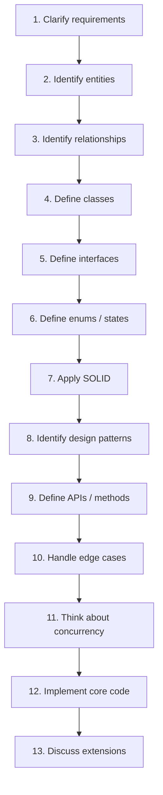
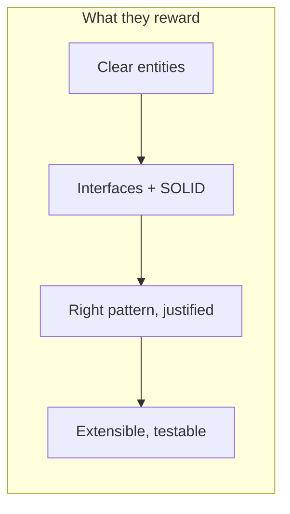
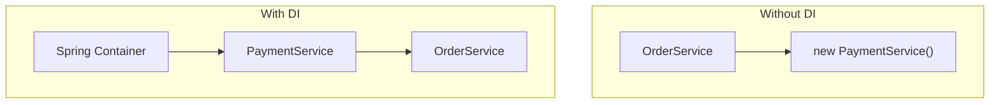
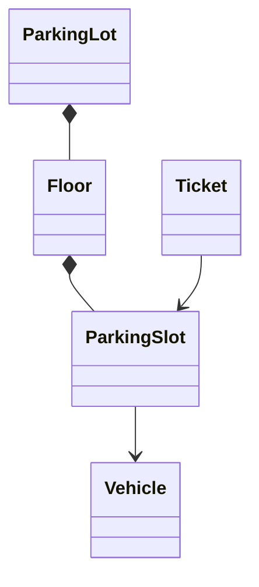

# LLD Interview Playbook

This is the operating manual: a **repeatable flow** to run on any prompt, the classic
problems to practice, the **patterns → problems** map, and a full worked example. The
goal is to walk in with a method, not to improvise.

<ProgressTracker id="lld-playbook" />

## Table of Contents

- [The 13-step flow](#the-13-step-flow)
- [What interviewers score](#what-interviewers-score)
- [The problems to practice](#the-problems-to-practice)
- [Patterns → problems mapping](#patterns--problems-mapping)
- [Dependency injection](#dependency-injection)
- [Concurrency in LLD](#concurrency-in-lld)
- [Collections & generics you'll reach for](#collections--generics-youll-reach-for)
- [Worked example: Parking Lot](#worked-example-parking-lot)
- [Most Asked Interview Questions](#most-asked-interview-questions)
- [Things You Should Know](#things-you-should-know)

## The 13-step flow

Run these in order **every time**. Narrating the structure is half the score.



<Tip>
Steps 1–3 decide the outcome. Weak designs almost always come from modelling the wrong
entities or missing a relationship — not from forgetting a pattern. Ask about scale,
concurrency, and likely future features **before** you draw a single class.
</Tip>

Good clarifying questions to open with:

- What are the core use cases we must support (and which are out of scope)?
- What's the scale — one machine or distributed? Single-threaded or concurrent?
- Which entities have a lifecycle (states)? Which rules govern transitions?
- What is likely to change or be added later? (This is where OCP earns its keep.)

## What interviewers score

They aren't counting classes. Three things dominate the score:

1. **Abstraction** — you program to capabilities (`PaymentProcessor`), not a method per
   variant.
2. **Loose coupling** — dependencies point at interfaces, injected from outside.
3. **Extensibility** — *"adding a new provider is a new class, not an edit to existing
   code."*



<Important>
Say the extensibility sentence out loud when it's true: *"If we add another payment
provider, I won't modify `PaymentService` — I'll add a class implementing the
strategy."* That one line signals Strategy + Factory + Open/Closed at once.
</Important>

## The problems to practice

Work through these end to end (all 13 steps), then reproduce from a blank page.

**Beginner**

- Parking Lot · Library Management · Tic-Tac-Toe · Snake & Ladder · ATM ·
  Vending Machine · Coffee Machine

**Intermediate**

- Elevator System · Car Rental · Movie Ticket Booking · Hotel Booking ·
  Restaurant Management · Splitwise · Chess · Deck of Cards · Logger ·
  Notification System

**Advanced**

- Cab Booking (Uber) · Payment System · E-commerce Order System ·
  Inventory Management · Rate Limiter · Task Scheduler · Distributed Cache ·
  Pub/Sub System

<Interview>
If you're short on time, master five that cover the full pattern spread: **Parking
Lot, Elevator, Splitwise, Vending Machine, Payment System**. Between them they exercise
Strategy, Factory, State, Observer, and Chain of Responsibility.
</Interview>

## Patterns → problems mapping

More useful than memorizing the Gang-of-Four list: know which patterns each classic
problem tends to pull in.

| Problem | Important patterns |
| --- | --- |
| Parking Lot | Strategy, Factory |
| Vending Machine | State, Factory |
| ATM | State, Chain of Responsibility |
| Elevator | Strategy, State |
| Payment | Strategy, Factory |
| Notification | Observer, Strategy, Factory |
| Splitwise | Strategy |
| Chess | Strategy, Factory |
| Logger | Singleton, Chain of Responsibility |
| Coffee Machine | State, Factory |
| File System | Composite |
| E-commerce | Strategy, Observer, Factory |
| Cab Booking | Strategy, Observer |
| Rate Limiter | Strategy |
| Task Scheduler | Strategy, Command |
| Order System | State, Observer, Strategy |

## Dependency injection

DI is the mechanism behind the Dependency Inversion Principle and is everywhere in
Spring. Instead of a class creating its collaborators, they're **supplied from
outside** — usually by the Spring container.



```java
// ✅ Constructor injection — preferred: fields can be final, deps are explicit & testable
@Service
class OrderService {
    private final PaymentGateway gateway;         // an abstraction
    OrderService(PaymentGateway gateway) {        // Spring supplies the bean
        this.gateway = gateway;
    }
}
```

<Tip>
Prefer **constructor injection** over field injection: it makes dependencies explicit,
allows `final` fields, fails fast if a dependency is missing, and needs no Spring to
unit-test (just pass a mock). Know the difference between **singleton** and
**prototype** bean scopes. Full detail: [Spring Core & DI](/docs/spring-core/).
</Tip>

## Concurrency in LLD

Step 11 is where Java LLD interviews go deep. Once you have a working single-threaded
design, be ready to make shared state safe.

- **Shared mutable state** is the enemy — a parking lot's free-slot count, a seat map, a
  wallet balance. Guard it.
- Reach for the right tool: `synchronized`/`ReentrantLock` for mutual exclusion,
  `ReadWriteLock` for read-heavy state, `AtomicInteger`/`AtomicLong` for counters,
  `ConcurrentHashMap` for concurrent maps, `Semaphore` for limited resources,
  `CountDownLatch`/`CyclicBarrier` for coordination.
- Name the hazards: **race conditions, deadlocks, starvation**. Show how you avoid them
  (e.g. consistent lock ordering to prevent deadlock).

```java
// Booking a seat safely: compare-and-set avoids a lost-update race
class SeatMap {
    private final ConcurrentHashMap<Integer, Boolean> booked = new ConcurrentHashMap<>();
    boolean book(int seat) {
        return booked.putIfAbsent(seat, true) == null;   // atomic; true only for winner
    }
}
```

Deeper treatment: [Concurrency](/docs/concurrency/).

## Collections & generics you'll reach for

LLD code is collection-heavy. Pick the structure by its behavior:

| Need | Use | Why |
| --- | --- | --- |
| Ordered list, random access | `ArrayList` | O(1) index, cache-friendly |
| FIFO queue / stack (deque) | `ArrayDeque` | fast both ends |
| Key → value lookup | `HashMap` | O(1) average |
| Sorted keys / range queries | `TreeMap` | O(log n), ordered |
| Priority ordering | `PriorityQueue` | heap, O(log n) push/poll |
| Concurrent map | `ConcurrentHashMap` | lock-striped, thread-safe |
| Unique set | `HashSet` / `TreeSet` | dedupe / sorted dedupe |

<Warning>
Anything you put in a `HashMap`/`HashSet` must honor the **`equals`/`hashCode`
contract** — override them together or lookups silently fail. See
[equals & hashCode](/docs/oop/equals-hashcode) and [Collections](/docs/collections/).
Use **generics** (`Repository<T>`, bounded types, PECS) to keep the model type-safe —
[Generics](/docs/generics/).
</Warning>

## Worked example: Parking Lot

A compact walk through the flow, ending in code. The point isn't the parking lot —
it's the *method*.

**1–3. Requirements, entities, relationships.** Multiple floors; slots sized for
motorcycle / car / truck; a vehicle takes a fitting free slot; issue a ticket on entry,
charge on exit. Entities: `ParkingLot` → `Floor` → `Slot`; `Vehicle`; `Ticket`. A lot
*composes* floors; a floor *composes* slots.



**4–6. Classes, interfaces, enums.** An enum for size; a **Strategy** interface for slot
allocation (nearest, per-floor, etc.) so the rule can change without touching the lot.

```java
enum VehicleType { MOTORCYCLE, CAR, TRUCK }

interface ParkingStrategy {                              // pluggable allocation rule
    Optional<ParkingSlot> findSlot(List<Floor> floors, VehicleType type);
}

class NearestFirstStrategy implements ParkingStrategy {
    public Optional<ParkingSlot> findSlot(List<Floor> floors, VehicleType type) {
        return floors.stream()
            .flatMap(f -> f.freeSlots(type).stream())
            .findFirst();
    }
}
```

**7–9. SOLID, patterns, APIs.** `ParkingLot` depends on the `ParkingStrategy`
abstraction (DIP) and never changes when a new strategy is added (OCP). Public API:
`park(Vehicle)` → `Ticket`, `unpark(Ticket)` → `Fee`.

```java
class ParkingLot {
    private final List<Floor> floors;
    private final ParkingStrategy strategy;               // injected
    private final Map<String, Ticket> active = new ConcurrentHashMap<>();

    ParkingLot(List<Floor> floors, ParkingStrategy strategy) {
        this.floors = floors; this.strategy = strategy;
    }

    // 10–11. Edge cases + concurrency: lock the chosen slot so two cars can't share it
    synchronized Ticket park(Vehicle v) {
        ParkingSlot slot = strategy.findSlot(floors, v.type())
            .orElseThrow(() -> new IllegalStateException("Lot full for " + v.type()));
        slot.assign(v);
        Ticket ticket = new Ticket(UUID.randomUUID().toString(), slot, Instant.now());
        active.put(ticket.id(), ticket);
        return ticket;
    }

    synchronized Fee unpark(String ticketId) {
        Ticket t = Optional.ofNullable(active.remove(ticketId))
            .orElseThrow(() -> new IllegalArgumentException("Unknown ticket"));
        t.slot().release();
        return FeeCalculator.compute(t, Instant.now());
    }
}
```

**12–13. Core code + extensions.** Working core above. Extensions to *offer* proactively:
pluggable pricing via another Strategy, an **Observer** to notify a display board when a
floor fills, and swapping the in-memory maps for a database — none of which change
`ParkingLot`'s core logic. That closing sentence is the extensibility signal
interviewers want.

## Most Asked Interview Questions

### Beginner
- Walk me through how you approach an LLD problem.
- What clarifying questions do you ask before designing?

### Intermediate
- Which patterns would a Vending Machine / Elevator / Splitwise use, and why?
- Constructor vs field injection — which do you prefer and why?

### Advanced
- Make your design thread-safe — where's the shared state and how do you guard it?
- How would you extend this design for a new requirement without editing existing code?

### Coding
- Design a Parking Lot (entities, interfaces, `park`/`unpark`, concurrency).
- Design Splitwise's expense-splitting with a Strategy for split types.

## Things You Should Know

### 🔴 Must Know
- The 13-step flow and the extensibility sentence.
- The three scoring signals: abstraction, loose coupling, extensibility.
- Dependency injection (constructor injection) and interface-based design.

### 🟡 Good to Know
- Patterns → problems mapping for the common questions.
- Guarding shared mutable state with locks/atomics/concurrent collections.
- Choosing the right collection by behavior.

### 🟢 Nice to Know
- Bean scopes (singleton vs prototype) and lifecycle.
- Deadlock avoidance via consistent lock ordering.
