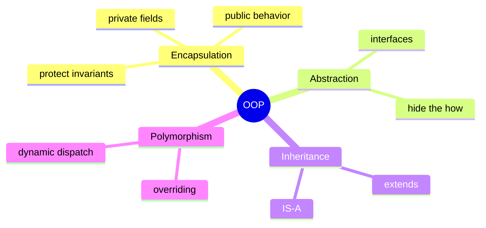
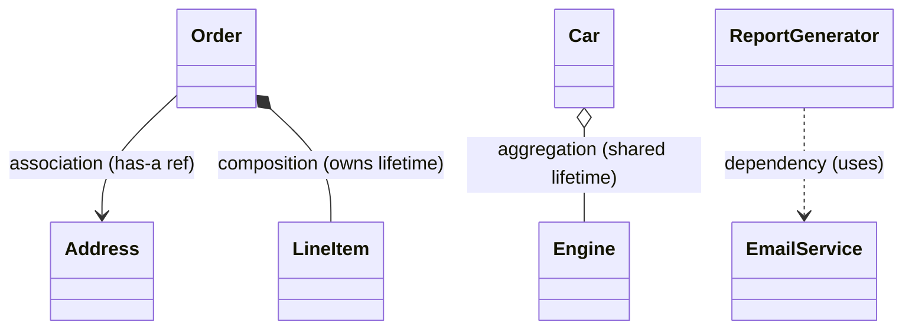
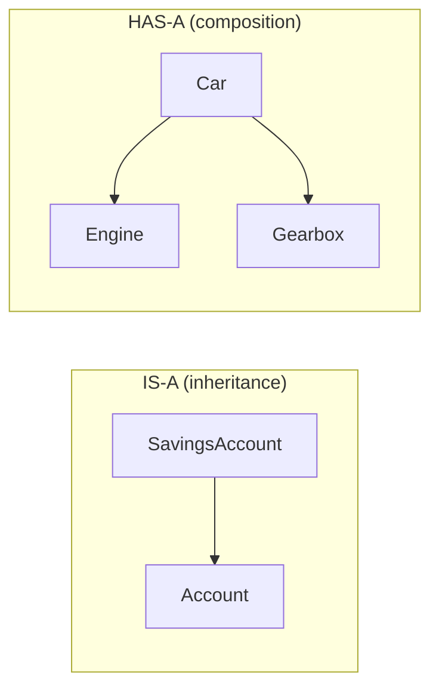

# OOP & Class Relationships

Every LLD answer is objects collaborating. Before patterns or SOLID, you must be
fluent in the raw material: **the four pillars, the four relationships, the
interface/abstract-class choice, and immutability**. This page is the LLD-focused
version of the [OOP section](/docs/oop/) — study both.

<ProgressTracker id="lld-oop" />

## Table of Contents

- [The core vocabulary](#the-core-vocabulary)
- [The four pillars](#the-four-pillars)
- [Overloading vs overriding](#overloading-vs-overriding)
- [Access modifiers](#access-modifiers)
- [Class relationships](#class-relationships)
- [Composition over inheritance](#composition-over-inheritance)
- [Interface vs abstract class](#interface-vs-abstract-class)
- [Encapsulation & immutability](#encapsulation--immutability)
- [UML you actually need](#uml-you-actually-need)
- [Most Asked Interview Questions](#most-asked-interview-questions)
- [Things You Should Know](#things-you-should-know)

## The core vocabulary

| Term | One-line definition |
| --- | --- |
| **Class** | A blueprint describing state (fields) and behavior (methods). |
| **Object** | A live instance of a class with its own state. |
| **Encapsulation** | Hide internal state; expose behavior through methods. |
| **Abstraction** | Expose *what* an object does, hide *how*. |
| **Inheritance** | A subtype reuses/extends a supertype (**is-a**). |
| **Polymorphism** | One reference type, many runtime behaviors. |
| **Constructor** | Special method that initializes a new object. |
| **Interface** | A contract/capability with no state (until `default`/`static`). |
| **Abstract class** | A partial base that can hold state and concrete methods. |

## The four pillars



**Encapsulation** — keep fields `private`, mutate through methods that protect
invariants. An object should never be observable in an invalid state.

**Abstraction** — callers depend on a capability (`PaymentProcessor.pay()`), not on
the concrete provider or its wiring.

**Inheritance** — model a genuine **is-a** relationship. `SavingsAccount` *is-a*
`Account`. Reach for it sparingly (see [composition over inheritance](#composition-over-inheritance)).

**Polymorphism** — the same call resolves to different behavior at runtime.

```java
PaymentProcessor processor = switch (method) {
    case CARD -> new CardProcessor();
    case UPI  -> new UpiProcessor();
};
processor.pay(order.total());   // resolved to the concrete type at runtime
```

## Overloading vs overriding

<Important>
**Overloading** is compile-time (same method name, different parameter lists, resolved
by the compiler). **Overriding** is runtime (a subclass redefines a superclass method
with the same signature, resolved by dynamic dispatch). Interviewers ask this
constantly.
</Important>

```java
class Printer {
    void print(String s) { }          // overloaded ...
    void print(int i) { }             // ... by parameter type
}

class Base { String name() { return "base"; } }
class Sub extends Base {
    @Override String name() { return "sub"; }   // overriding
}
```

| | Overloading | Overriding |
| --- | --- | --- |
| Resolved | Compile time | Runtime (dynamic dispatch) |
| Signature | Must differ (params) | Must be identical |
| Relationship | Same class (or inherited) | Subclass ↔ superclass |
| `@Override` | Not applicable | Recommended |

## Access modifiers

From most to least restrictive — the tool of encapsulation:

| Modifier | Same class | Same package | Subclass | Everywhere |
| --- | :---: | :---: | :---: | :---: |
| `private` | ✅ | ❌ | ❌ | ❌ |
| *(package-private)* | ✅ | ✅ | ❌ | ❌ |
| `protected` | ✅ | ✅ | ✅ | ❌ |
| `public` | ✅ | ✅ | ✅ | ✅ |

<Tip>
Default to `private`. Widen access only when a real collaborator needs it. Public
mutable fields are the fastest way to break an invariant.
</Tip>

## Class relationships

Interviewers probe whether you can name the relationship between two classes and
justify it. There are four, ordered by strength of coupling.



**Dependency (uses-a)** — the weakest link. One class uses another transiently, often
as a method parameter or local. If it changes, you may need to recompile.

```java
class ReportGenerator {
    byte[] build(Data d, EmailService email) {  // depends on EmailService here only
        ...
    }
}
```

**Association (has-a reference)** — a lasting link where both objects live
independently. A `Student` references a `School`; neither owns the other's lifetime.

**Aggregation (has-a, shared lifetime)** — a whole/part link where the part can
outlive the whole. A `Team` has `Player`s, but a player still exists if the team
disbands.

```java
class Team {
    private final List<Player> players;   // players passed in; not owned
    Team(List<Player> players) { this.players = players; }
}
```

**Composition (owns lifetime)** — the part cannot meaningfully exist without the
whole; the whole creates and destroys it. An `Order` owns its `LineItem`s.

```java
class Order {
    private final List<LineItem> items = new ArrayList<>();  // created & owned here
    void addItem(Product p, int qty) { items.add(new LineItem(p, qty)); }
}
```

<Interview>
The classic prompt: *Car ── Engine*. If the engine **cannot meaningfully exist
without the car**, that's **composition**. If the engine is supplied from outside and
can be swapped or reused, it's **aggregation**. State the lifetime rule explicitly —
that's what they're testing.
</Interview>

## Composition over inheritance

This is the most important design instinct in LLD. Inheritance is tempting because it
reuses code, but it couples the subclass to the superclass's implementation and only
fits a true **is-a** relationship.

```java
// ❌ Inheritance abused for reuse: a Stack is NOT-a Vector's full API
class Stack<E> extends Vector<E> { }   // now callers can insert in the middle!

// ✅ Composition: expose only the stack operations, delegate storage
class Stack<E> {
    private final List<E> items = new ArrayList<>();   // HAS-A list
    void push(E e) { items.add(e); }
    E pop() { return items.remove(items.size() - 1); }
}
```



<Warning>
Deep inheritance hierarchies are a classic LLD smell. They create fragile base
classes, force subclasses to inherit methods they don't want (an ISP violation), and
make behavior hard to change at runtime. Prefer composing small, focused
collaborators. Full treatment: [Composition over Inheritance](/docs/oop/composition-over-inheritance).
</Warning>

## Interface vs abstract class

A very common Java interview fork. Both enable polymorphism; they differ in **what
they can hold** and **why you'd choose them**.

```java
// Interface: a capability/contract. A class can implement many.
interface PaymentProcessor {
    void pay(Money amount);
}

// Abstract class: shared state + partial behavior for related classes.
abstract class Payment {
    protected final Money amount;                 // shared state
    protected Payment(Money amount) { this.amount = amount; }
    protected void audit() { /* shared behavior */ }
    abstract void process();                       // subclass fills this in
}
```

| | Interface | Abstract class |
| --- | --- | --- |
| Purpose | Define a **capability/contract** | Share **state + behavior** among related classes |
| State (fields) | No instance state | Yes (instance fields) |
| Multiple inheritance | A class can implement **many** | A class extends **one** |
| Methods | `abstract`, `default`, `static`, `private` | abstract + concrete |
| Constructors | None | Yes |
| Relationship | "can-do" (`Comparable`, `Serializable`) | "is-a-kind-of" |

<Interview>
*"Why choose an interface over an abstract class?"* — Because a class can implement
many interfaces (Java has no multiple class inheritance), interfaces express
capabilities that cut across unrelated types, and they keep you decoupled from any
base implementation. **Reach for an abstract class only when related types share real
state or a common algorithm skeleton** (Template Method). When in doubt, start with an
interface. More: [Interfaces & Abstraction](/docs/oop/interfaces-and-abstraction).
</Interview>

## Encapsulation & immutability

Immutable objects are simpler to reason about and **inherently thread-safe** — they
never change after construction, so no synchronization is needed to share them.

The recipe for an immutable value object:

1. Mark the class `final` (no subclass can add mutability).
2. Make every field `private final`.
3. No setters; set all state in the constructor.
4. **Defensively copy** mutable inputs and outputs.
5. Validate invariants in the constructor (fail fast).

```java
public final class Money {
    private final BigDecimal amount;
    private final Currency currency;

    public Money(BigDecimal amount, Currency currency) {
        if (amount == null || currency == null) throw new IllegalArgumentException();
        if (amount.scale() > currency.getDefaultFractionDigits())
            throw new IllegalArgumentException("too many decimals");
        this.amount = amount;        // BigDecimal is already immutable
        this.currency = currency;
    }

    public Money plus(Money other) {                 // returns a NEW instance
        requireSameCurrency(other);
        return new Money(amount.add(other.amount), currency);
    }
    // no setters; getters only
}
```

For a mutable field, copy on the way in *and* out:

```java
public final class Route {
    private final List<String> stops;
    public Route(List<String> stops) { this.stops = List.copyOf(stops); }   // defensive copy in
    public List<String> stops() { return List.copyOf(stops); }              // and out
}
```

<Tip>
Modern Java gives you immutability for free with **records** — great for DTOs and
value objects. Use the **Builder** pattern when a class has many optional fields.
Both are covered in [Design Patterns](/docs/low-level-design/design-patterns) and
[Modern Java](/docs/java-8-plus/).
</Tip>

```java
public record Money(BigDecimal amount, Currency currency) {
    public Money {                                   // compact constructor validates
        if (amount == null || currency == null) throw new IllegalArgumentException();
    }
}
```

## UML you actually need

You don't need to be a UML expert — you need to sketch a class diagram on a
whiteboard and read the relationship arrows. Memorize these five.

```text
┌────────────────────┐
│     «interface»     │
│  PaymentProcessor   │
├────────────────────┤
│ + pay(amount): void │
└────────────────────┘
          ▲
          │  implements (hollow triangle, dashed)
┌────────────────────┐
│    CardProcessor    │
├────────────────────┤
│ - gateway: Gateway  │
├────────────────────┤
│ + pay(amount): void │
└────────────────────┘
```

| Notation | Meaning |
| --- | --- |
| Solid line, hollow triangle | **Inheritance** (`extends`) |
| Dashed line, hollow triangle | **Realization** (`implements`) |
| Solid line, plain arrow | **Association** (has-a reference) |
| Solid line, hollow diamond | **Aggregation** (shared lifetime) |
| Solid line, filled diamond | **Composition** (owned lifetime) |
| Dashed line, open arrow | **Dependency** (uses) |

A class box has three compartments: **name**, **fields**, **methods**. Prefix
visibility with `+` public, `-` private, `#` protected.

## Most Asked Interview Questions

### Beginner
- What are the four pillars of OOP? Give a backend example of each.
- Difference between a class and an object?
- What does a constructor do, and can it be overloaded?

### Intermediate
- Overloading vs overriding — when is each resolved?
- Association vs aggregation vs composition — give the lifetime rule.
- Interface vs abstract class — why choose one over the other?

### Advanced
- Why prefer composition over inheritance? Show a case where inheritance breaks.
- How do you make a class immutable, and why does that help concurrency?

### Coding
- Implement an immutable `Money` value object with validation and `plus`.
- Model *Car ── Engine* and justify composition vs aggregation.

## Things You Should Know

### 🔴 Must Know
- The four pillars with real examples.
- Overloading (compile-time) vs overriding (runtime).
- The four relationships and their lifetime rules.
- Interface vs abstract class and *why*.

### 🟡 Good to Know
- Composition over inheritance and its smells.
- Immutability recipe and defensive copying; records.
- Access modifiers as an encapsulation tool.

### 🟢 Nice to Know
- UML class-diagram arrow notation.
- How the JVM implements dynamic dispatch (vtables).
