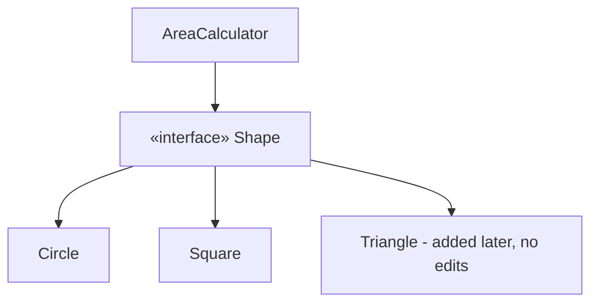
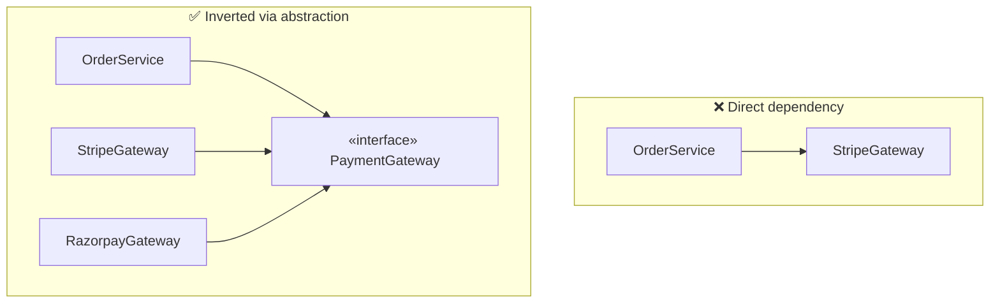
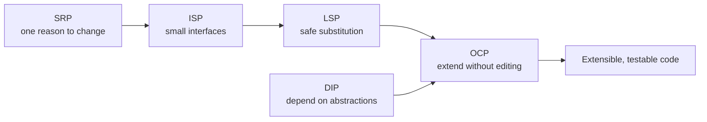

# SOLID Principles

SOLID is probably the **single most important LLD topic**. The bar in interviews is
not reciting the five names — it's being able to **look at a class and point out which
principle it violates**, then refactor it. This page pairs every principle with a
violation and its fix.

<ProgressTracker id="lld-solid" />

## Table of Contents

- [The five at a glance](#the-five-at-a-glance)
- [S — Single Responsibility](#s--single-responsibility)
- [O — Open/Closed](#o--openclosed)
- [L — Liskov Substitution](#l--liskov-substitution)
- [I — Interface Segregation](#i--interface-segregation)
- [D — Dependency Inversion](#d--dependency-inversion)
- [How the principles reinforce each other](#how-the-principles-reinforce-each-other)
- [Most Asked Interview Questions](#most-asked-interview-questions)
- [Things You Should Know](#things-you-should-know)

## The five at a glance

| Letter | Principle | One-line rule |
| --- | --- | --- |
| **S** | Single Responsibility | A class should have **one reason to change**. |
| **O** | Open/Closed | Open for **extension**, closed for **modification**. |
| **L** | Liskov Substitution | Subtypes must be **substitutable** for their base type. |
| **I** | Interface Segregation | Don't force clients to depend on methods they **don't use**. |
| **D** | Dependency Inversion | Depend on **abstractions**, not concretions. |

<Important>
The unifying goal is **manageable change**. Requirements always shift; SOLID keeps a
small change from rippling across the codebase. When you justify a design, phrase it
as *"when requirement X changes, only class Y is touched."*
</Important>

## S — Single Responsibility

A class should have exactly one reason to change. Mixing responsibilities means a
change to one concern risks breaking the others.

```java
// ❌ Three reasons to change: business rules, persistence, and email formatting
class Invoice {
    void calculateTotal() { /* business */ }
    void saveToDatabase() { /* persistence */ }
    void sendEmail() { /* notification */ }
}
```

```java
// ✅ One responsibility each
class Invoice { BigDecimal calculateTotal() { ... } }        // domain
class InvoiceRepository { void save(Invoice i) { ... } }     // persistence
class InvoiceNotifier { void email(Invoice i) { ... } }      // notification
```

<Tip>
A quick test: describe the class in one sentence. If you need "and" — *"it calculates
totals **and** saves **and** emails"* — it probably has too many responsibilities.
</Tip>

## O — Open/Closed

You should be able to add new behavior by **adding code**, not by editing existing,
tested code. The classic smell is a growing `if/else` or `switch` over a type.

```java
// ❌ Every new shape edits this method — closed to extension, open to modification
class AreaCalculator {
    double area(Object shape) {
        if (shape instanceof Circle c)      return Math.PI * c.r() * c.r();
        else if (shape instanceof Square s) return s.side() * s.side();
        // adding Triangle means editing here again...
        throw new IllegalArgumentException();
    }
}
```

```java
// ✅ New shapes are new classes; the calculator never changes
interface Shape { double area(); }
record Circle(double r) implements Shape { public double area() { return Math.PI*r*r; } }
record Square(double side) implements Shape { public double area() { return side*side; } }

class AreaCalculator {
    double total(List<Shape> shapes) {
        return shapes.stream().mapToDouble(Shape::area).sum();   // untouched forever
    }
}
```



<Interview>
Open/Closed is what makes the **Strategy** and **Factory** patterns valuable: adding a
new payment provider becomes "write a new class implementing the interface", not "edit
a switch in the service." When you say *"we won't modify existing code to add a
provider"*, you are invoking OCP.
</Interview>

## L — Liskov Substitution

Anywhere the base type is expected, a subtype must work **without surprising the
caller** — no weakened guarantees, no thrown "unsupported" exceptions.

```java
// ❌ The textbook violation: a Square is-not-a substitutable Rectangle
class Rectangle {
    protected int w, h;
    void setWidth(int w)  { this.w = w; }
    void setHeight(int h) { this.h = h; }
    int area() { return w * h; }
}
class Square extends Rectangle {
    void setWidth(int w)  { this.w = w; this.h = w; }   // breaks caller expectations
    void setHeight(int h) { this.w = h; this.h = h; }
}
// A method that sets width=5, height=4 and expects area 20 gets 16 for a Square.
```

```java
// ✅ Don't force the hierarchy; model the real invariant
interface Shape { int area(); }
record Rectangle(int w, int h) implements Shape { public int area() { return w*h; } }
record Square(int side) implements Shape { public int area() { return side*side; } }
```

<Warning>
A common LSP break is a subclass that **throws `UnsupportedOperationException`** for an
inherited method (e.g. an immutable list extending a mutable list interface). If a
subtype can't honor the contract, it shouldn't be a subtype — split the interface
(see ISP).
</Warning>

## I — Interface Segregation

No client should be forced to depend on methods it doesn't use. Prefer several small,
role-specific interfaces over one fat interface.

```java
// ❌ A fat interface forces robots to implement eating
interface Worker {
    void work();
    void eat();
}
class Robot implements Worker {
    public void work() { ... }
    public void eat() { throw new UnsupportedOperationException(); }   // smell
}
```

```java
// ✅ Segregate by capability; implement only what applies
interface Workable { void work(); }
interface Eatable  { void eat(); }

class Human implements Workable, Eatable { public void work(){} public void eat(){} }
class Robot implements Workable          { public void work(){} }
```

<Tip>
ISP and LSP are siblings: a `UnsupportedOperationException` in an implementation is
usually a sign the interface is too fat (ISP) *and* the subtype can't be substituted
(LSP). Splitting the interface fixes both.
</Tip>

## D — Dependency Inversion

High-level policy should not depend on low-level details. Both should depend on
**abstractions**. Concretely: inject an interface, don't `new` a concrete class inside
your business logic.

```java
// ❌ OrderService is welded to a concrete gateway — hard to swap or test
class OrderService {
    private final StripeGateway gateway = new StripeGateway();   // concretion
    void checkout(Order o) { gateway.charge(o.total()); }
}
```

```java
// ✅ Depend on an abstraction; the concrete impl is supplied from outside
interface PaymentGateway { void charge(Money amount); }

class OrderService {
    private final PaymentGateway gateway;                        // abstraction
    OrderService(PaymentGateway gateway) { this.gateway = gateway; }  // injected
    void checkout(Order o) { gateway.charge(o.total()); }
}
```



<Interview>
DIP is the *principle*; **Dependency Injection** is the *mechanism* (constructor
injection preferred), and an **IoC container** like Spring is the *tool* that supplies
the concrete bean. Inverting the dependency is also what makes the class testable —
you can inject a mock gateway. See [Spring Core & DI](/docs/spring-core/).
</Interview>

## How the principles reinforce each other

They aren't independent rules — they compound.



- **SRP** produces small classes, which naturally suggest **small interfaces (ISP)**.
- Small, honest interfaces make **substitution (LSP)** safe.
- Substitutable abstractions let you **extend without modifying (OCP)**.
- **DIP** points your dependencies at those abstractions, so new implementations plug
  in cleanly.

<Important>
In an interview, don't lecture the five definitions. **Spot a violation in the given
code, name the principle, and refactor.** That demonstrates the skill; reciting the
acronym doesn't.
</Important>

## Most Asked Interview Questions

### Beginner
- What does SOLID stand for?
- Give a one-line example of a Single Responsibility violation.

### Intermediate
- Explain Open/Closed with a code example.
- What's the relationship between DIP and dependency injection?

### Advanced
- Show a Liskov Substitution violation and fix it.
- Given this class, identify every SOLID violation and refactor it.

### Coding
- Refactor an `AreaCalculator` switch into an OCP-compliant design.
- Split a fat `Worker` interface to satisfy ISP.

## Things You Should Know

### 🔴 Must Know
- All five principles and a violation + fix for each.
- DIP vs dependency injection vs IoC container.
- Open/Closed as the basis for Strategy and Factory.

### 🟡 Good to Know
- LSP and ISP together explain `UnsupportedOperationException` smells.
- How SRP feeds ISP feeds LSP feeds OCP.

### 🟢 Nice to Know
- Contravariance of arguments / covariance of returns in LSP.
- Law of Demeter and "tell, don't ask" as related heuristics.
