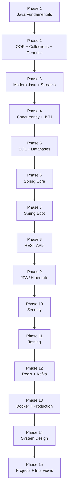

# Backend Learning Roadmap

This roadmap turns scattered topics into an ordered path. Each phase builds on the
previous one. Do not skip ahead — backend engineering is cumulative. You cannot
reason about `@Transactional` without understanding transactions, and you cannot
understand transactions without understanding databases.

<ProgressTracker id="roadmap-overview" />

## The Path

## How to use this roadmap

For every phase you should be able to check off five stages before moving on:

- **Read** — you have read and can follow the material.
- **Understand** — you can explain it to someone else without notes.
- **Implement** — you have written working code that uses it.
- **Practice** — you have solved problems or debugged real issues with it.
- **Interview Ready** — you can answer questions and defend trade-offs under pressure.

---

## Phase 1 — Java Fundamentals

**What to learn:** JDK/JRE/JVM, compilation pipeline, primitive vs reference types,
operators, control flow, arrays, `String`/`StringBuilder`, `static`/`final`/`this`/`super`.

**Why it matters:** Every backend line you write is Java. Shaky fundamentals produce
subtle bugs (mutating strings in loops, `==` vs `equals`, integer overflow).

**Prerequisites:** None.

**What to build:** A small CLI calculator and a text-processing utility.

**Interview readiness:** Explain `.java → .class → JVM`, why Java is "compiled and
interpreted", and the difference between stack and heap for a simple method call.

➡️ Start: [Java Fundamentals](/docs/java-fundamentals/)

---

## Phase 2 — OOP, Collections, Generics

**What to learn:** Classes/objects, the four pillars, interfaces vs abstract classes,
composition over inheritance, `equals`/`hashCode`, the collection hierarchy,
`ArrayList`/`HashMap`/`TreeMap`, generic classes/methods, wildcards and PECS.

**Why it matters:** Backend code is objects collaborating. APIs return collections.
Getting `equals`/`hashCode` wrong breaks `HashMap`, `HashSet`, and caching.

**What to build:** An in-memory repository (`Map`-backed) with generics.

**Interview readiness:** `ArrayList` vs `LinkedList`, how `HashMap` works internally,
why `equals` and `hashCode` must change together.

➡️ [OOP](/docs/oop/) · [Collections](/docs/collections/) · [Generics](/docs/generics/)

---

## Phase 3 — Modern Java + Streams

**What to learn:** Lambdas, functional interfaces, method references, the Stream API
(`map`/`filter`/`reduce`/`collect`/`groupingBy`), `Optional`, records, sealed classes,
switch expressions.

**Why it matters:** Modern Spring code is stream- and lambda-heavy. Records are the
default for DTOs. `Optional` shapes repository return types.

**What to build:** Rewrite a loop-heavy report generator using streams and records.

➡️ [Modern Java (8+)](/docs/java-8-plus/)

---

## Phase 4 — Concurrency + JVM

**What to learn:** Threads, `ExecutorService`, thread pools, `synchronized`/`volatile`,
locks, atomics, `CompletableFuture`, concurrent collections, virtual threads; JVM memory
areas, garbage collection, and diagnosing `OutOfMemoryError`.

**Why it matters:** A web server is inherently concurrent — one thread per request.
Shared mutable state causes the hardest production bugs.

**What to build:** A bounded thread-pool job runner with graceful shutdown.

➡️ [Concurrency](/docs/concurrency/) · [JVM Internals](/docs/jvm/)

---

## Phase 5 — SQL + Databases

**What to learn:** Tables, keys, constraints, normalization, indexes, joins, aggregation,
window functions, transactions, ACID, isolation levels, `EXPLAIN`.

**Why it matters:** Most backend performance problems are database problems. ORMs hide
SQL until they can't.

**What to build:** Design a normalized schema for an e-commerce domain and write the
reporting queries.

➡️ [SQL & Databases](/docs/database/) · [JDBC](/docs/jdbc/)

---

## Phase 6 — Spring Core

**What to learn:** IoC, dependency injection, beans, `ApplicationContext`, component
scanning, bean lifecycle and scopes, configuration, AOP and proxies.

**Why it matters:** Spring Boot is Spring Core with defaults. Understanding the container
explains "magic" like `@Transactional` and `@Cacheable`.

➡️ [Spring Core](/docs/spring-core/)

---

## Phase 7 — Spring Boot

**What to learn:** Auto-configuration, starters, `application.yml`, profiles, Actuator,
the Controller → Service → Repository layering.

**What to build:** A running Spring Boot app that returns JSON from a `@RestController`.

➡️ [Spring Boot](/docs/spring-boot/)

---

## Phase 8 — REST APIs

**What to learn:** REST principles, HTTP methods and status codes, path/query params,
request/response bodies, pagination/sorting/filtering, versioning, idempotency, DTOs,
OpenAPI.

**What to build:** A fully documented CRUD API with validation and error responses.

➡️ [REST API Development](/docs/rest-api/)

---

## Phase 9 — JPA / Hibernate

**What to learn:** Entities, persistence context, dirty checking, relationships,
lazy vs eager loading, the N+1 problem, JPQL, native queries, locking.

➡️ [Spring Data JPA](/docs/spring-data-jpa/)

---

## Phase 10 — Security

**What to learn:** Authentication vs authorization, the security filter chain,
`PasswordEncoder`/BCrypt, JWT access/refresh tokens, roles, CORS, CSRF, OAuth2 basics.

**What to build:** Stateless JWT authentication end to end.

➡️ [Spring Security](/docs/security/)

---

## Phase 11 — Testing

**What to learn:** The test pyramid, JUnit 5, Mockito, `@SpringBootTest`, `MockMvc`,
`@DataJpaTest`, Testcontainers.

➡️ [Testing](/docs/testing/)

---

## Phase 12 — Redis + Kafka

**What to learn:** Cache patterns and invalidation, TTL, distributed locks, rate limiting;
Kafka topics/partitions/offsets/consumer groups and delivery semantics.

➡️ [Redis & Caching](/docs/redis-caching/) · [Kafka & Messaging](/docs/kafka-messaging/)

---

## Phase 13 — Docker + Production

**What to learn:** Images/containers, multi-stage Dockerfiles, Compose; logging, metrics,
health checks, tracing, resilience patterns, migrations.

➡️ [Docker & Deployment](/docs/docker/) · [Production Backend](/docs/production/)

---

## Phase 14 — System Design

**What to learn:** Scalability, availability, CAP, replication, sharding, caching,
queues, and full designs for real systems.

➡️ [System Design](/docs/system-design/)

---

## Phase 15 — Projects + Interviews

**What to build:** Ship the three capstone projects, then drill categorized interview
questions for every topic.

➡️ [Projects](/docs/projects/) · [Interview Preparation](/docs/interview-preparation/)

<Tip>
Momentum beats intensity. One topic per day, fully checked off, is worth more than
skimming ten topics you cannot explain.
</Tip>
